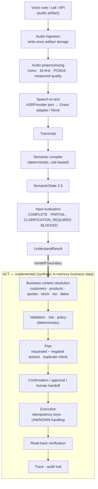

# VaaniOS

**Speak it. Structure it. Execute.**

VaaniOS is an agentic voice-to-business-action platform designed to turn messy,
code-switched voice instructions into typed, evaluated business intent. It is built so
that **raw speech never directly becomes an irreversible business action**. The current
challenge scenario, built for the Gnani AI Great Indian AI Internship Challenge, focuses
on Indian SME workflows: Hinglish voice notes from a noisy wholesale shop floor.


> [!IMPORTANT]
> **Current status:** the **UNDERSTAND** side (audio → transcript → semantic state →
> input evaluation → handoff) is implemented and tested. The **ACT** side (business
> context, agent orchestration, validation, risk/policy, approval, execution,
> verification) is **designed but not yet implemented**. Nothing in this repository
> creates orders, invoices or dispatches today.

The Python package is called `vaaniflow` (the project's working name in the design
documents is *VaaniFlow*).

---

## Table of contents

- [Why VaaniOS](#why-vaanios)
- [Architecture](#architecture)
- [What UNDERSTAND produces](#what-understand-produces)
- [Example: the canonical voice note](#example-the-canonical-voice-note)
- [Safety behaviour of the semantic layer](#safety-behaviour-of-the-semantic-layer)
- [Getting started](#getting-started)
- [Using the pipeline](#using-the-pipeline)
- [Gnani speech-to-text integration](#gnani-speech-to-text-integration)
- [Testing](#testing)
- [Quality checks](#quality-checks)
- [Repository structure](#repository-structure)
- [Developer workflow](#developer-workflow)
- [Current status](#current-status)
- [Design principles](#design-principles)
- [Known limitations](#known-limitations)
- [Documentation map](#documentation-map)
- [Contributing](#contributing)
- [License](#license)

---

## Why VaaniOS

A wholesale trader sends an 8-second WhatsApp voice note:

> *"Arre Suresh, Sharma Builders ko turant 200 bag Ultratech cement dispatch karo. Rate
> wahi lagana jo parso bataya tha—chaar sau bees rupaye per bag plus GST. Invoice bana
> ke mujhe WhatsApp pe approve karne bhej do."*

Turning that into a business action safely requires more than transcription. The
request mixes Hindi and English, spells numbers as words, refers to a price "from the
day before yesterday", asks for several actions, and names a customer that may match
more than one business record.

VaaniOS separates the problem into two layers:

| Layer | Question it answers | Status |
|---|---|---|
| **UNDERSTAND** | *What did the human actually mean, and is it specified well enough to act on?* | Implemented |
| **ACT** | *Given that meaning and what the business knows, what should happen?* | Planned |

The interesting engineering is the boundary: the semantic layer may interpret language,
but it must **not invent business facts** (customer IDs, SKUs, quotes, stock, tax
amounts, calendar dates) and must **not silently resolve ambiguity** into something that
looks executable.

---

## Architecture



### Layers inside UNDERSTAND

| Stage | Responsibility | Main code |
|---|---|---|
| Ingestion & storage | Persist the original audio unchanged; artifacts are **write-once** | `infrastructure/storage/local.py`, `application/services/ingest_audio.py` |
| Preprocessing | Decode, down-mix, resample to 16 kHz PCM16 WAV, measure quality, record lineage | `audio/local.py`, `audio/quality.py`, `application/services/preprocess_audio.py` |
| ASR | Provider-neutral port; Gnani and mock adapters | `application/ports/asr.py`, `providers/gnani.py`, `providers/mock.py` |
| Semantic compiler | Transcript → typed `SemanticState`; language only, no business lookups | `semantic/` |
| Input evaluation | Is the semantic request complete, coherent and actionable? | `semantic/evaluation.py` |
| Handoff | One typed object for ACT | `domain/schemas/understand.py`, `application/services/understand.py` |

(Paths are relative to `apps/api/src/vaaniflow/`.)

Dependency direction follows the design: the domain schemas import no framework or
provider code, application services depend on ports, and the Gnani SDK is only
imported inside `providers/gnani.py`.

---

## What UNDERSTAND produces

The ACT side consumes exactly one object: **`UnderstandResult`**
([`domain/schemas/understand.py`](apps/api/src/vaaniflow/domain/schemas/understand.py)).

| Field | Contents |
|---|---|
| `transcript` | What was said: provider-neutral text, language, opaque provider metadata |
| `audio` | Original and processed artifact ids, measured processed-audio metadata, applied operations |
| `semantic_state` | What was understood (`SemanticState`, schema `2.0`) |
| `evaluation` | `actionability` plus structured, machine-readable reasons |

`SemanticState` ([`domain/schemas/semantic.py`](apps/api/src/vaaniflow/domain/schemas/semantic.py))
contains typed slots, each carrying a character span into the transcript and a
rule-tier confidence:

| Slot | Meaning |
|---|---|
| `intent`, `requested_actions[]` | Primary intent and every requested action (with recipient/channel where spoken) |
| `negated_actions[]` | Actions the user explicitly said **not** to perform |
| `customer`, `addressee` | Names **as spoken** — never a customer ID |
| `items[]` | Product mention bound to its own quantity and canonical unit |
| `pricing[]` | Spoken amount and/or historical-price reference, currency, per-unit, item binding |
| `tax` | The spoken instruction only (e.g. "plus GST" → exclusive) — no rate, no amount |
| `references[]` | "same rate", "previous quote", "that order", "it" — with the slot they fill |
| `temporal_expressions[]` | Linguistic offsets/weekdays/dates — never a resolved calendar date |
| `corrections[]` | Superseded and corrected values ("200 — actually 220") |
| `ambiguities[]` | Semantic ambiguity only (entity, value, temporal, action, reference, scope) |
| `compiler`, `source_transcript_id`, `run_id` | Provenance |

Input evaluation ([`semantic/evaluation.py`](apps/api/src/vaaniflow/semantic/evaluation.py))
classifies the state:

| Actionability | Meaning |
|---|---|
| `COMPLETE` | Every required slot is stated and coherent |
| `PARTIAL` | Understood, but a reference ("same rate", "that order") must be resolved by business context |
| `CLARIFICATION_REQUIRED` | The user must supply or disambiguate something |
| `BLOCKED` | Not an actionable request (no intent, empty transcript, unusable audio) |

Each reason has a code, an effect, the slot it concerns, evidence and related ids; the
overall actionability is the most restrictive reason. This is **semantic** completeness
only — it never consults business data and does not replace ACT-side validation or
policy.

---

## Example: the canonical voice note

The scenario from [Why VaaniOS](#why-vaanios) is a golden test
([`tests/unit/semantic/test_compiler.py`](apps/api/tests/unit/semantic/test_compiler.py)).
Its compiled state, abridged:

```text
intent             CREATE_DISPATCH_ORDER
addressee          "Suresh"
customer           "Sharma Builders"            (a name, not a customer ID)
items              200 bag × "Ultratech cement"  (not a SKU)
pricing            SPOKEN_WITH_HISTORICAL_REFERENCE
                   420 INR per bag  ← linked to reference "Rate wahi"
tax                GST, EXCLUSIVE ("plus GST")
references         HISTORICAL_PRICE → slot PRICE, anchored to "parso"
temporal           "parso" → DAY_OFFSET:-2, PAST (evidence: qualifies the historical reference)
requested actions  DISPATCH, CREATE_INVOICE_DRAFT,
                   SEND_NOTIFICATION (to speaker, WhatsApp), REQUEST_APPROVAL (by speaker)
urgency            HIGH ("turant")

evaluation         PARTIAL
  - CONTEXT_REFERENCE_UNRESOLVED   "Rate wahi" must be resolved against business records
  - RELATIVE_DATE_NEEDS_CLOCK      "parso" becomes a date only with the run clock + timezone
```

What UNDERSTAND **deliberately does not decide**:

- which customer record "Sharma Builders" is;
- which catalogue SKU "Ultratech cement" is;
- whether ₹420 is actually the quote given two days ago, or still valid;
- whether 200 bags are in stock, the GST amount, or the calendar date of "parso";
- whether anything should be invoiced or dispatched.

Those are ACT responsibilities. No order, invoice or dispatch is created by this
repository.

---

## Safety behaviour of the semantic layer

The compiler must not turn uncertainty into something that looks executable. These
behaviours are covered by regression tests
([`tests/unit/semantic/test_safety_regressions.py`](apps/api/tests/unit/semantic/test_safety_regressions.py)):

| Input | Result |
|---|---|
| "Don't dispatch 200 bags of UltraTech cement to Sharma Builders" | No requested action; `DISPATCH` recorded in `negated_actions`; `CLARIFICATION_REQUIRED` (`NEGATED_ACTION`) |
| "… dispatch mat karo" / "… dispatch nahi karna" | Same — the Hinglish negation is bound to the verb, not the whole sentence |
| "200 bags UltraTech ya ACC cement" / "UltraTech or ACC cement" | Product left empty; `ENTITY_AMBIGUITY` with candidates `UltraTech cement`, `ACC cement` |
| "Dispatch 200 ya 300 bags" / "200 or 300 bags" | Quantity left empty; `VALUE_AMBIGUITY` with candidates `200 bag`, `300 bag` |
| "Sharma Builders ko 2000 bag …" | Stays exactly **2000** — judging whether 2000 is plausible is ACT validation |
| "Send 200 bags, actually 220 …" | Current quantity 220; the correction event keeps 200 as superseded |
| "Dispatch day after tomorrow, not tomorrow …" / "200 bag, nahi nahi, 220 bag" | Treated as corrections — **not** as negation of the action |
| "Sharma Builders ko …, Kumar Constructions ko …" | `ENTITY_AMBIGUITY` on customer instead of picking one |
| "kal" / "parso" / "narso" without tense evidence | `TEMPORAL_AMBIGUITY` instead of guessing past or future |

> [!NOTE]
> These guarantees are about **interpretation**. The layer that prevents unsafe
> **execution** — validation, risk/policy, approval and verification — belongs to ACT
> and is not implemented yet.

---

## Getting started

### Prerequisites

- **Python 3.12** (the project requires `>=3.12,<3.13`)
- `git`
- A Gnani API key only if you want to call the live speech-to-text service (not needed
  for tests or for the mock pipeline)

Audio decoding uses `soundfile`, whose wheels bundle `libsndfile` on common platforms.

### Install

```bash
git clone https://github.com/VaaniOS/VaaniOS.git
cd VaaniOS

python3.12 -m venv .venv
source .venv/bin/activate          # Windows: .venv\Scripts\activate

python -m pip install --upgrade pip
python -m pip install -e ".[dev]"
```

This installs the `vaaniflow` package (from `apps/api/src`) in editable mode together
with the development tools (`pytest`, `pytest-asyncio`, `ruff`, `mypy`).

### Verify the installation

```bash
pytest -q
```

### Environment variables

The application code itself reads no environment variables. The only variable in use is
read by the Gnani SDK:

| Variable | Purpose | Required? | Example |
|---|---|---|---|
| `GNANI_API_KEY` | API key read by `gnani.stt.GnaniSTTClient` when no key is passed to its constructor | Only for live Gnani calls | `GNANI_API_KEY=<your-gnani-api-key>` |

```bash
export GNANI_API_KEY="<your-gnani-api-key>"
```

There is no `.env` loader or settings module yet. Never commit keys (`.env` files are
git-ignored).

### Entry points

> [!NOTE]
> There is **no HTTP server or CLI yet**. `fastapi` and `uvicorn` are declared
> dependencies, but `apps/api/src/vaaniflow/api/` is an empty package. The supported
> entry points are the application services, used from Python as shown below.

---

## Using the pipeline

### Transcript → UnderstandResult

```python
from datetime import UTC, datetime
from uuid import uuid4

from vaaniflow.application.services.understand import UnderstandTranscriptService
from vaaniflow.domain.schemas.transcript import Transcript
from vaaniflow.semantic import InputEvaluator, SemanticCompiler

text = (
    "Arre Suresh, Sharma Builders ko turant 200 bag Ultratech cement dispatch karo. "
    "Rate wahi lagana jo parso bataya tha—chaar sau bees rupaye per bag plus GST. "
    "Invoice bana ke mujhe WhatsApp pe approve karne bhej do."
)
transcript = Transcript(
    transcript_id=uuid4(), provider="mock", text=text, created_at=datetime.now(UTC)
)

service = UnderstandTranscriptService(compiler=SemanticCompiler(), evaluator=InputEvaluator())
result = service.execute(transcript=transcript)

print(result.actionability)  # PARTIAL
print([a.action_type.value for a in result.semantic_state.requested_actions])
print(result.model_dump_json(indent=2))  # the full handoff object
```

### Audio file → UnderstandResult (mock ASR, no network)

```python
import io
from datetime import UTC, datetime
from pathlib import Path
from uuid import uuid4

from vaaniflow.application.services.ingest_audio import IngestAudioService
from vaaniflow.application.services.preprocess_audio import PreprocessAudioService
from vaaniflow.application.services.transcribe_audio import TranscribeAudioService
from vaaniflow.application.services.understand import (
    UnderstandAudioService,
    UnderstandTranscriptService,
)
from vaaniflow.audio import LocalAudioPreprocessor, describe_wav
from vaaniflow.domain.schemas.artifact import AudioArtifact
from vaaniflow.infrastructure.storage.local import LocalArtifactStorage
from vaaniflow.providers.mock import MockASR
from vaaniflow.semantic import InputEvaluator, SemanticCompiler

storage = LocalArtifactStorage(Path("./artifacts"))
wav = Path("voice_note.wav").read_bytes()  # a PCM WAV file

artifact_id = uuid4()
artifact = IngestAudioService(artifact_storage=storage).execute(
    artifact=AudioArtifact(
        artifact_id=artifact_id,
        storage_ref=f"local://original/{artifact_id}.wav",
        metadata=describe_wav(artifact_id=artifact_id, wav_bytes=wav),
        created_at=datetime.now(UTC),
    ),
    audio=io.BytesIO(wav),
)

asr = MockASR(text="Sharma Builders ko 200 bags UltraTech cement dispatch karo.")

pipeline = UnderstandAudioService(
    preprocess_audio=PreprocessAudioService(
        artifact_storage=storage, audio_preprocessor=LocalAudioPreprocessor()
    ),
    transcribe_audio=TranscribeAudioService(artifact_storage=storage, asr_provider=asr),
    understand_transcript=UnderstandTranscriptService(
        compiler=SemanticCompiler(), evaluator=InputEvaluator()
    ),
)
result = pipeline.execute(artifact=artifact, run_id=uuid4(), language_hint="hi-IN")

print(result.audio.processed_metadata.quality_class, result.actionability)
```

The original audio is stored under `artifacts/original/` and the processed 16 kHz WAV
under `artifacts/processed/<artifact-id>.wav`. Storage is write-once: storing to an
existing reference raises `ArtifactAlreadyExistsError`. Stage failures raise typed port
errors (`ArtifactStorageError`, `AudioPreprocessorError`, `ASRProviderError`); no
transcript or semantic state is fabricated.

To use Gnani instead of the mock, replace `asr` as shown in the next section.

---

## Gnani speech-to-text integration

The adapter lives in [`providers/gnani.py`](apps/api/src/vaaniflow/providers/gnani.py)
and implements the provider-neutral `ASRProvider` port
([`application/ports/asr.py`](apps/api/src/vaaniflow/application/ports/asr.py)). It wraps
the `gnani-vachana` SDK (`gnani.stt.GnaniSTTClient`), which is a declared dependency.

```python
from gnani.stt import GnaniSTTClient

from vaaniflow.providers.gnani import GnaniASRProvider

client = GnaniSTTClient()  # reads GNANI_API_KEY from the environment
asr = GnaniASRProvider(client=client)  # format="verbatim", itn_native_numerals=False by default
```

What the adapter does:

- calls `GnaniSTTClient.transcribe_bytes` with a filename hint derived from the
  artifact's MIME type (`audio.wav`, `audio.ogg`, `audio.mp3`, …);
- uses `ASRInput.language_hint` as the language code, defaulting to `en-IN`;
- exposes the SDK's `format` (`"verbatim"` or `"transcribe"`, the latter enabling
  inverse text normalisation) and `itn_native_numerals` options;
- maps the response into the provider-neutral `Transcript`; `model`,
  `processing_time` and `end_to_end_latency` are kept as opaque `provider_metadata`;
- leaves `detected_languages` empty, because the REST response reports no language
  detection;
- maps failures to typed errors:

| Situation | Error |
|---|---|
| SDK `InvalidAudioError` | `ASRProviderInvalidInputError` |
| SDK `AuthenticationError`, `APIError`, network `OSError` | `ASRProviderUnavailableError` |
| SDK `ValueError` (bad language code / format) | `ASRProviderConfigurationError` |
| `success: false`, missing/empty transcript, non-dict payload, anything else | `ASRProviderError` |

Isolation: nothing outside `providers/gnani.py` imports the Gnani SDK. Tests use a fake
client ([`tests/unit/providers/test_gnani.py`](apps/api/tests/unit/providers/test_gnani.py),
[`tests/integration/test_understand_pipeline.py`](apps/api/tests/integration/test_understand_pipeline.py)),
so the suite needs no credentials or network.

> [!WARNING]
> The live Gnani API has **not** been exercised by this repository's tests. The
> assumption that this SDK fulfils the "Prisma" ASR role in the design documents, and
> the default language/ITN settings for Hinglish speech, are recorded as unverified in
> [ADR-017](System-Design/18-architecture-decisions.md). Do not treat the live
> integration as production-ready.

---

## Testing

```bash
pytest -q
```

At the time of writing the suite collects and passes **519 tests**.

| Category | Location | What it covers |
|---|---|---|
| Unit | `apps/api/tests/unit/` | Storage, preprocessing and quality analysis, ASR adapters, tokenizer and number words, compiler, references, corrections, temporal parsing, ambiguity, input evaluation |
| Contract | `apps/api/tests/contracts/` | `SemanticState` and `UnderstandResult` invariants, JSON round-trips, absence of business identifiers, existing ACT-side domain contracts |
| Integration | `apps/api/tests/integration/` | End-to-end UNDERSTAND pipeline with real local storage and WAV preprocessing, mock ASR and a fake Gnani client; ACT orchestration and HTTP API |
| ACT safety regressions | `apps/api/tests/integration/test_act_safety.py`, `test_api_approval.py`, `test_p1_*.py`, `test_p2_hardening.py` | Actionability and negation gates, approval binding and supersession, temporal quote matching, quote validity, pricing authority, UNKNOWN outcomes and reconciliation, partial execution, verification, duplicate orders, confirmation, operator resolution, audit trail — asserting repository state |
| ACT unit | `apps/api/tests/unit/{context,validation,policy,execution,handoff,evaluation,traces,infrastructure}/` | Resolvers, validation engine, policy matrix, tools, verifier, approvals, handoff, sandbox scenarios A–J |
| Safety regressions | `apps/api/tests/unit/semantic/test_safety_regressions.py` | Negation, product/customer/quantity/price alternatives, numeric fidelity, fallback products |

Useful subsets:

```bash
pytest -q apps/api/tests/unit
pytest -q apps/api/tests/contracts
pytest -q apps/api/tests/integration
pytest -q apps/api/tests/unit/semantic
pytest -q apps/api/tests/unit/semantic/test_safety_regressions.py
pytest -q -k canonical            # the canonical voice-note tests
```

Semantic tests assert exact extracted values (via a `summarize()` helper in
`tests/unit/semantic/conftest.py`) rather than mere presence.

---

## Quality checks

These are the gates used for every change:

```bash
pytest -q              # full test suite
ruff check .           # lint (configured in pyproject.toml)
ruff format --check .  # formatting check, line length 100
mypy apps/api/src      # static type checking of the source tree
git diff --check       # whitespace errors / conflict markers in the working tree
```

---

## Repository structure

```text
VaaniOS/
├── CLAUDE.md                     # repository operating contract / dev instructions
├── pyproject.toml                # package, dependencies, pytest/ruff/mypy config
├── System-Design/                # canonical architecture and design (01–24, ADRs)
├── docs/
│   └── architecture/
│       └── understand-handoff.md # UNDERSTAND → ACT consumer guide
└── apps/
    └── api/
        ├── src/vaaniflow/
        │   ├── domain/
        │   │   ├── schemas/       # SemanticState, UnderstandResult, Transcript, audio
        │   │   ├── models/        # business models used by ACT (orders, quotes, approvals, …)
        │   │   └── policies/      # decision / risk / authorization models
        │   ├── application/
        │   │   ├── ports/         # ArtifactStorage, ASRProvider, AudioPreprocessor, business data
        │   │   ├── schemas/       # ASRInput, preprocessing input/result
        │   │   └── services/      # ingest, preprocess, transcribe, understand,
        │   │                      # orchestrator (ACT), run audit
        │   ├── audio/             # local preprocessor, quality analysis
        │   ├── providers/         # Gnani and mock ASR adapters
        │   ├── infrastructure/
        │   │   ├── storage/       # local write-once artifact storage
        │   │   └── repositories/  # in-memory repositories + synthetic business data
        │   ├── semantic/          # compiler, references, corrections, temporal,
        │   │                      # ambiguity, input evaluation, lexicon
        │   ├── context/           # business-context resolution (ACT)
        │   ├── validation/ policy/ # deterministic validation, risk, policy, confirmation
        │   ├── execution/         # plans, tools, idempotent execution, verifier,
        │   │                      # approvals, duplicate detection
        │   ├── handoff/ traces/   # structured human handoff, run traces
        │   ├── evaluation/        # failure-injection sandbox (scenarios A–J)
        │   ├── api/               # FastAPI app and routers
        │   └── config/
        └── tests/
            ├── unit/
            ├── contracts/
            └── integration/
```

---

## Developer workflow

| You are changing… | Look in |
|---|---|
| A domain contract (`SemanticState`, `UnderstandResult`, transcript, audio metadata) | `apps/api/src/vaaniflow/domain/schemas/` |
| A port or an application service | `apps/api/src/vaaniflow/application/` |
| A provider adapter (ASR) | `apps/api/src/vaaniflow/providers/` |
| Audio preprocessing / quality | `apps/api/src/vaaniflow/audio/` |
| Language understanding or input evaluation | `apps/api/src/vaaniflow/semantic/` |
| Tests | `apps/api/tests/{unit,contracts,integration}/`, mirroring the source layout |
| Architecture decisions | [`System-Design/18-architecture-decisions.md`](System-Design/18-architecture-decisions.md) |

- Work on a feature branch and merge into `main`; the design suggests branches such as
  `feature/audio-semantic` and `feature/agent-execution`
  ([System-Design 16](System-Design/16-development-plan.md)).
- [`CLAUDE.md`](CLAUDE.md) contains the repository's development rules (inspect before
  editing, typed interfaces, no fabricated provider APIs, never bypass validation, keep
  mocks deterministic). It applies to human and AI contributors alike.
- If a change conflicts with `System-Design/`, record the decision as an ADR instead of
  drifting silently.

---

## Current status

### Implemented (UNDERSTAND)

- Audio artifact ingestion with **write-once** local storage and path-traversal protection
- Audio preprocessing to 16 kHz mono PCM16 WAV with **measured** quality metadata
  (peak level, clipping, speech/silence ratio, estimated SNR, noise level, quality class)
- Processed-artifact lineage (source artifact id, applied operations)
- Provider-neutral ASR port with Gnani and mock adapters and typed provider errors
- Transcript contract with opaque provider metadata
- Deterministic semantic compiler for English and romanised Hindi (Hinglish):
  - intent and multiple requested actions (dispatch, invoice draft, approval,
    notification, order create/update/cancel, inventory/price checks), urgency
  - customer, addressee and product mentions; product↔quantity binding into items
  - digits and spoken number words ("chaar sau bees", "do sau", "two hundred")
  - structured pricing and spoken tax instructions
  - references with target slots; corrections with history
  - temporal expressions (relative days incl. kal/parso/narso, weeks, weekdays, dates)
  - semantic ambiguity and action negation
  - character spans, rule-tier confidence and compiler provenance
- Input evaluation with structured reasons
- Typed `UnderstandResult` handoff and end-to-end application services
- Unit, contract, integration and safety-regression tests; architecture docs and ADRs

### Implemented (ACT)

Over synthetic, in-memory business data (`infrastructure/repositories/synthetic_data.py`):

- Context resolution: customers, products, quotes, inventory, tax rules, relative dates
- Deterministic validation, risk scoring and a policy matrix (no LLM decides execution)
- Explicit plans built only from requested − negated actions; one approval per plan
- Approval bound to run, plan fingerprint and business snapshot, re-validated at execution
- Execution with idempotency keys, read-back verification of every write, UNKNOWN handling
- Structured human handoff, bound confirmation, operator resolution of UNKNOWN outcomes
- Business-level duplicate order detection
- Traces, an end-to-end audit endpoint, and a failure-injection sandbox (scenarios A–J)
- FastAPI HTTP API (`apps/api/src/vaaniflow/api/`)

### ACT safety semantics

| Behaviour | Rule |
|---|---|
| Pricing authority | The execution price is the price of exactly one quote valid on the business date. A spoken price is a claim compared against it (mismatch → confirmation). **No applicable quote → no executable sale** (handoff); a referenced rate with no matching quote → clarification. No other quote is substituted. |
| Historical references | "Rate wahi jo parso bataya tha" matches only quotes given on the date of the temporal expression linked to *the price's own reference*. "parso" is resolved against when the user spoke, not when approval happens. |
| Approval | Every business write needs an approval bound to its run, plan fingerprint and business snapshot. A new instruction on the run supersedes any pending approval (`SUPERSEDED`, kept for audit). Approval re-validates; a changed plan or snapshot expires it. Approver identity is recorded for audit only — there is no authentication yet, so `actor_authenticated` is always `false` and identity never authorizes anything. |
| Confirmation | A CONFIRM decision creates a confirmation bound to one run, the exact warnings asked about and the business snapshot. A yes/no reply (`POST /runs/{id}/confirm`) answers only that confirmation; if the facts changed it expires. Confirmation never executes — approval is still required. |
| Duplicate orders | An open equivalent order (same customer, items, price, destination) blocks a new one; a completed one blocks only on the same business day. Orders the system creates stay `DRAFT` unless dispatched, so an identical undispatched request stays blocked until that order is handled. If orders cannot be read, nothing is created (handoff). |
| Verification | Every planned write has a read-back contract (`execution/plan.py: VERIFICATION_CONTRACTS`); a tool without one is never planned. Only a verified step is reported as done. |
| UNKNOWN outcomes | A timeout or exception after a write may have committed: the step is `UNKNOWN`, reconciled by read-back by idempotency key, never blindly retried. An operator can resolve it (`POST /runs/{id}/executions/{execution_id}/resolve`); success requires a verified record committed by that exact operation. History (`prior_*`, `resolution`) is never erased. |
| Partial execution | Each step reports VERIFIED / FAILED / UNKNOWN / NOT_ATTEMPTED; runs end `COMPLETED`, `PARTIALLY_COMPLETED`, `FAILED` or `HANDOFF`. Nothing is rolled back and no rollback is claimed. Messages state record statuses (a DRAFT order reads as DRAFT). |
| Business clock | Production uses the real clock. `VAANIFLOW_BUSINESS_CLOCK=synthetic` (or an ISO-8601 instant) pins the API to the synthetic dataset's 2026-10-17 12:00 IST for demos; the evaluation runner always uses it. |

### Next (not implemented)

- Authentication and authorization of operators (identities are recorded, not verified)
- Persistent storage (all repositories are in-memory)
- Operator dashboard, WhatsApp/telephony integrations
- Text-to-speech responses (Gnani Timbre in the design)
- Multi-item orders, catalog or operator-set pricing

---

## Design principles

1. **Speech is not an action.** A transcript is untrusted input that becomes typed state
   before anything else happens.
2. **Semantic interpretation is not business truth.** Names stay names; IDs, prices,
   stock and dates come from business systems.
3. **Ambiguity must remain ambiguity.** Alternatives are surfaced with their candidates,
   never silently resolved.
4. **Corrections are first-class information.** The corrected value is current; the
   superseded value is preserved.
5. **Negation must never silently invert intent.** "Don't dispatch" is recorded as a
   negated action, not a dispatch.
6. **Business facts belong to business context**, not to model output.
7. **Consequential execution requires validation, approval and verification.**
8. **Provider integrations stay replaceable** behind ports.
9. **Domain contracts are explicit and typed** — strict Pydantic models that reject
   unknown fields.
10. **Every discovered failure becomes a regression test.**

---

## Known limitations

- **Audio formats:** only WAV input is tested. The local preprocessor decodes through
  `libsndfile`; in a manual check with the bundled libsndfile 1.2.2 it also decoded
  FLAC, Ogg Vorbis, Ogg Opus and MP3, but these paths are untested. M4A/AAC is not
  supported, and `describe_wav` always labels metadata as `audio/wav`.
- **No advanced audio processing:** no VAD trimming, noise suppression,
  dereverberation or speech enhancement. Quality analysis is a frame-energy heuristic.
- **Devanagari transcripts** are not interpreted (they evaluate to `BLOCKED`, not to
  wrong facts).
- **Irregular Hindi number words** for 21–99 (e.g. "pachchis") are not parsed.
- **Hedged quantities** ("around 200", "lagbhag 200") are treated as exact values.
- **Live Gnani API** is not used by the automated tests; language/ITN defaults are
  unverified.
- **No ASR confidence propagation** — semantic confidence is rule-tier and ordinal,
  not a calibrated probability.
- **Unknown products** without a known category noun are captured positionally at low
  confidence (e.g. "200 bags Birla Gold" → 0.55) and must be resolved downstream.
- **Negation coverage** is bounded to the supported English/Hinglish patterns
  (don't / do not / never; mat / nahi / nahin); "dispatch karo nahi to …" is
  conservatively treated as negation.
- **Unusable audio still reaches ASR**; input evaluation blocks it afterwards.
- **No event/commitment extraction** ([System-Design 21](System-Design/21-event-system.md)).
- **ACT runs on synthetic in-memory data only**; nothing is persisted across restarts.
- **One line item per request**; multi-item requests are clarified, not executed.
- **No catalog prices**: a customer without an applicable quote cannot be sold to by
  voice (ADR-019). `ACCEPTED` quotes are not treated as executable pricing because the
  model does not define their semantics.
- **Clarification replies are not merged**: `/clarify` takes a complete new instruction;
  the open clarification record (what was understood, what is missing) is preserved and
  superseded, but partial answers are not merged into the earlier request.
- **No authentication**: approver, rejector, confirmer and resolver identities are
  recorded claims.
- **Relative dates**: only day offsets (kal/parso/…) are resolved; a spoken weekday or
  explicit date linked to a rate is treated as unresolved (clarification).
- `numpy` is imported directly but is only installed transitively (via `scipy`).

---

## Documentation map

| Document | Contents |
|---|---|
| [CLAUDE.md](CLAUDE.md) | Mission, engineering principles and development rules |
| [System-Design/README.md](System-Design/README.md) | Index of the design documents |
| [01 · System overview](System-Design/01-system-overview.md) | Product boundary, goals, trust boundary, layers |
| [02 · Architecture](System-Design/02-architecture.md) | Components, runtime topology, dependency direction |
| [03 · Data model](System-Design/03-data-model.md) | Domain entities and provenance |
| [04 · Audio pipeline](System-Design/04-audio-pipeline.md) | Preprocessing and quality design |
| [05 · Semantic compiler](System-Design/05-semantic-compiler.md) | Voice-to-structured-state design |
| [06 · Context resolution](System-Design/06-context-resolution.md) | ACT: entity, quote, inventory and temporal resolution |
| [08 · Validation, policy, risk](System-Design/08-validation-policy-risk.md) | ACT: deterministic safeguards |
| [09 · Execution & verification](System-Design/09-execution-verification.md) | ACT: approval, idempotency, read-back |
| [16 · Development plan](System-Design/16-development-plan.md) | UNDERSTAND / ACT team split |
| [18 · Architecture decisions](System-Design/18-architecture-decisions.md) | ADR-001 … ADR-018 |
| [20 · Gnani integration](System-Design/20-gnani-integration.md) | Provider adapter strategy |
| [docs/architecture/understand-handoff.md](docs/architecture/understand-handoff.md) | UNDERSTAND → ACT handoff contract and consumer rules |

The remaining design documents (agent orchestration, human handoff, sandbox, observability,
API contracts, security, frontend, demo scenarios, testing strategy, events, repository
blueprint, state machines, agent reliability) are listed in
[System-Design/README.md](System-Design/README.md). They describe intended behaviour;
most of it is not implemented yet.

---

## Contributing

1. Make one focused change at a time; do not mix unrelated refactors or formatting.
2. Add or update tests — exact-value assertions for semantic behaviour, and a regression
   test for every bug you fix.
3. Run the [quality checks](#quality-checks) before opening a pull request.
4. Update `System-Design/` (or add an ADR) when a contract or behaviour changes.
5. Never commit secrets or real customer data; demo data must be clearly synthetic.
6. Respect the UNDERSTAND / ACT boundary: the semantic layer interprets language and
   must not query or invent business facts.

---

## License

No license is currently specified for this repository.

Until a license is added, the repository should be treated as all rights reserved.
