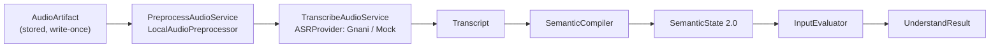
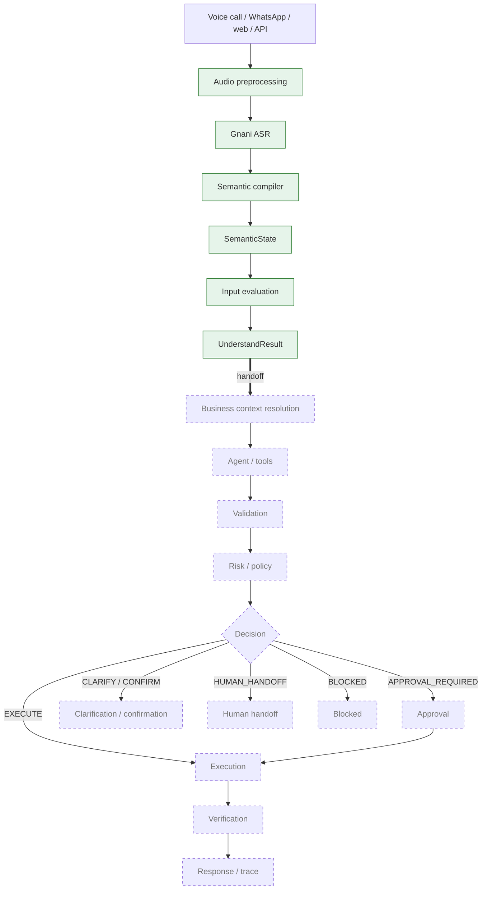
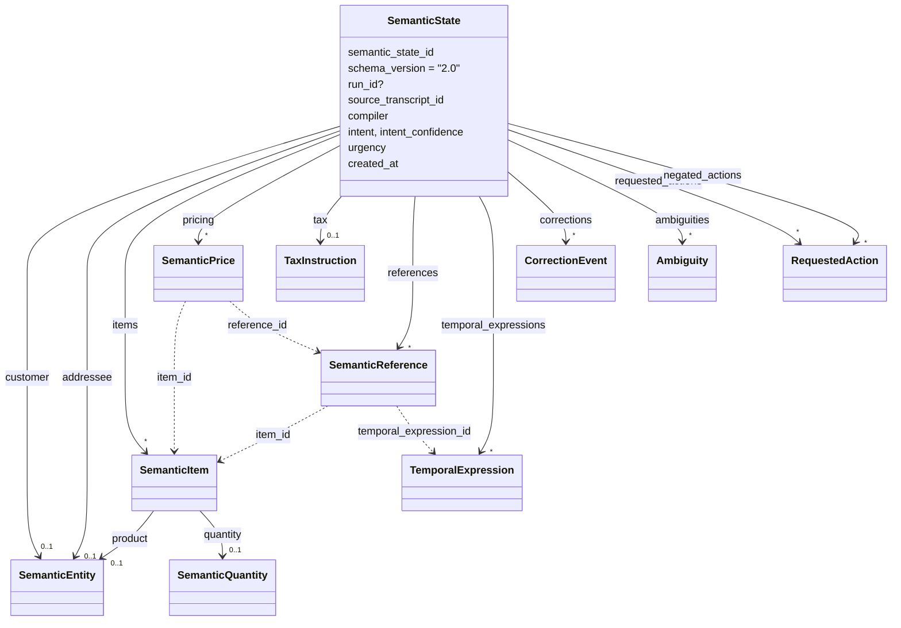
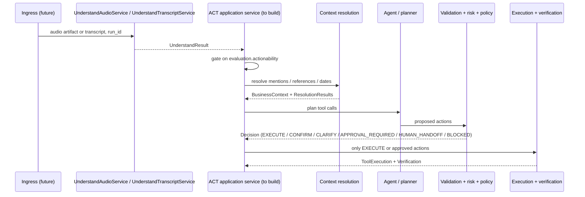

# VaaniOS Engineering Handover

> **From:** Arjun (UNDERSTAND owner) · **To:** ACT owner · **Repository state:** `7b4d9d9`
> (`docs: add project README and align audio format docs`) on `main`.
>
> **UNDERSTAND is frozen and ready for ACT to consume.** ACT is designed but not
> implemented. The Shared Layer has not started.

Status labels used throughout this document:

| Label | Meaning |
|---|---|
| **IMPLEMENTED / TESTED** | Code exists in `apps/api/src/vaaniflow/` and is exercised by tests in `apps/api/tests/` |
| **CONTRACT ONLY** | A typed Pydantic schema exists (and has construction tests) but no logic uses it |
| **DESIGNED / NOT IMPLEMENTED** | Described in `System-Design/` only; no code |

All source paths below are relative to the repository root.

---

## Table of contents

1. [Handover summary](#1-handover-summary)
2. [Project vision](#2-project-vision)
3. [Current system architecture](#3-current-system-architecture)
4. [Ownership map](#4-ownership-map)
5. [What has been completed — UNDERSTAND](#5-what-has-been-completed--understand)
6. [Critical safety fixes already completed](#6-critical-safety-fixes-already-completed)
7. [Canonical demo scenario](#7-canonical-demo-scenario)
8. [UNDERSTAND → ACT handoff contract](#8-understand--act-handoff-contract)
9. [Critical files](#9-critical-files)
10. [Git / commit history](#10-git--commit-history)
11. [Repository setup — START HERE](#11-repository-setup--start-here)
12. [Running the current system](#12-running-the-current-system)
13. [Current quality gate](#13-current-quality-gate)
14. [ACT Phase 1 — Business context](#14-act-phase-1--business-context)
15. [ACT Phase 2 — Context resolution](#15-act-phase-2--context-resolution)
16. [ACT Phase 3 — Agent orchestration](#16-act-phase-3--agent-orchestration)
17. [ACT Phase 4 — Validation](#17-act-phase-4--validation)
18. [ACT Phase 5 — Risk / policy](#18-act-phase-5--risk--policy)
19. [ACT Phase 6 — Human handoff](#19-act-phase-6--human-handoff)
20. [ACT Phase 7 — Approval](#20-act-phase-7--approval)
21. [ACT Phase 8 — Execution](#21-act-phase-8--execution)
22. [ACT Phase 9 — Verification](#22-act-phase-9--verification)
23. [Connecting ACT to UNDERSTAND](#23-connecting-act-to-understand)
24. [Shared — Sandbox / evaluation](#24-shared--sandbox--evaluation)
25. [Shared — Evaluation metrics](#25-shared--evaluation-metrics)
26. [Shared — Trace / observability](#26-shared--trace--observability)
27. [Shared — Dashboard](#27-shared--dashboard)
28. [Shared — Integration](#28-shared--integration)
29. [Shared — Final demo](#29-shared--final-demo)
30. [After the Shared Layer — productization](#30-after-the-shared-layer--productization)
31. [Frozen contracts](#31-frozen-contracts)
32. [Known limitations](#32-known-limitations)
33. [Troubleshooting](#33-troubleshooting)
34. [Recommended development order](#34-recommended-development-order)
35. [Definition of done](#35-definition-of-done)
36. [First 5 things to do](#36-first-5-things-to-do)
37. [Final handover checklist](#37-final-handover-checklist)
38. [If you only read one section](#38-if-you-only-read-one-section)

---

## 1. Handover summary

| | |
|---|---|
| **Purpose** | Turn messy, code-switched voice instructions into typed, evaluated business intent, so that raw speech never directly becomes an irreversible business action |
| **HEAD** | `7b4d9d9` on `main` (local `main` is 1 commit ahead of the local `origin/main` tracking ref, so `7b4d9d9` itself may not be pushed yet; `d9e06b8` and earlier are) |
| **Boundary** | Implementation stops at `UnderstandResult` (`apps/api/src/vaaniflow/domain/schemas/understand.py`) |
| **Done (Arjun)** | Audio ingestion and preprocessing, Gnani STT adapter, transcript contract, semantic compiler (entities, items, pricing, references, corrections, temporal, ambiguity, negation), input evaluation, `UnderstandResult`, end-to-end Understand services, 296 tests, docs |
| **ACT (since handover)** | Implemented: context resolution, validation, risk/policy, planning, approval, execution, verification, handoff, sandbox, traces, HTTP API — then hardened in three audited phases (P0 safety `2ac8390`, P1 correctness `ff28e0c`, P2 production hardening) |
| **Remaining (shared)** | Dashboard, integration, persistence, authentication, demo polish |

The rows above describe the state at handover. The ACT sections below (§14–§23)
remain the design brief; the current implementation is summarised next.

### Current state (after P0, P1 and P2 hardening)

ACT runs over synthetic in-memory data. Its safety semantics:

- **Plans** come only from requested − negated actions; one line item per request.
- **Pricing**: the execution price is the price of exactly one quote applicable on
  the business date (VALID and `quoted_on ≤ date ≤ valid_until`). A spoken price is a
  claim (mismatch → bound confirmation). No applicable quote → no executable sale
  (handoff). A historical reference only matches quotes given on the date of the
  temporal expression linked to the price's own reference (ADR-019).
- **Approval** is bound to run, plan fingerprint and business snapshot, re-validated at
  execution, superseded by any new instruction on the run, and fully audited (run, plan,
  snapshot, actors, timestamps, rejection/expiry reasons, `superseded_by`, produced
  records). Identities are claims (`actor_authenticated = false`); they never authorize.
- **Confirmation** (`POST /runs/{id}/confirm`) answers one pending confirmation of one
  run, bound to its warnings and snapshot; it never executes (approval still required).
- **Duplicate orders**: an open equivalent order blocks a new one; a completed one
  only on the same business day; an unreadable order store blocks (handoff).
- **Execution**: every write has a read-back contract and is verified; a timeout or
  exception is `UNKNOWN`, reconciled by read-back, never blindly retried; operators can
  resolve it (`POST /runs/{id}/executions/{execution_id}/resolve`) only with a verified
  record committed by that operation. Per-step outcomes; `PARTIALLY_COMPLETED`; no
  rollback claimed; messages state record statuses.
- **Clarification and handoff** preserve what was understood (actions, references,
  temporal expressions, pricing claims) and what is unresolved; `GET /runs/{id}/audit`
  links instruction → plan → context → validation → approval → executions →
  verifications → business records → handoffs → trace.
- **Business clock**: real by default; `VAANIFLOW_BUSINESS_CLOCK=synthetic` for demos.

---

## 2. Project vision

**Speak it. Structure it. Execute.**

```text
voice  →  structured business intent  →  validated, approved, verified action
```

Raw speech is untrusted, probabilistic input: ASR mis-hears numbers, people correct
themselves, refer to "the same rate as the day before yesterday", offer alternatives
("UltraTech ya ACC"), or say *not* to do something. Treating a transcript as a command
risks irreversible mistakes (wrong customer, 2000 instead of 200 bags, dispatching
something the user said not to dispatch). So the system splits the problem:

| Layer | Question | Status |
|---|---|---|
| **UNDERSTAND** | What did the human actually mean, and is it specified well enough? | IMPLEMENTED / TESTED |
| **ACT** | Given that meaning and what the business knows, what should happen — and did it actually happen? | CONTRACT ONLY / DESIGNED |
| **SHARED** | Can we prove it behaves safely under failure, and can an operator see why? | DESIGNED / NOT IMPLEMENTED |

Design properties (from [`CLAUDE.md`](../CLAUDE.md) and
[`System-Design/`](../System-Design/README.md)):

- **Channel-agnostic.** UNDERSTAND starts from a stored audio artifact or a
  transcript; WhatsApp, phone or web are future ingress adapters.
- **Business-agnostic architecture, domain-specific demo.** The canonical scenario is
  wholesale construction material, but the contracts are not tied to cement.
- **Provider-agnostic.** Gnani sits behind the `ASRProvider` port; tests use mocks.
- **Challenge scenario:** Gnani AI Great Indian AI Internship Challenge — an Indian
  SME owner sends a Hinglish WhatsApp voice note from a noisy shop floor.

---

## 3. Current system architecture

### Implemented path (IMPLEMENTED / TESTED)



Orchestrated by `UnderstandAudioService` (audio entry) and `UnderstandTranscriptService`
(transcript entry) in `apps/api/src/vaaniflow/application/services/understand.py`.

### Target architecture



Solid green = IMPLEMENTED / TESTED. Dashed = DESIGNED / NOT IMPLEMENTED. Input evaluation
and `UnderstandResult` were added to the design by ADR-013
([`System-Design/18-architecture-decisions.md`](../System-Design/18-architecture-decisions.md)).

---

## 4. Ownership map

| Area | Arjun (UNDERSTAND) | You (ACT) | Shared |
|---|:---:|:---:|:---:|
| Audio pipeline (ingestion, preprocessing, quality) | ✅ owner | | |
| ASR / Gnani STT boundary | ✅ owner | | |
| Semantic compiler, references, corrections, temporal, ambiguity, negation | ✅ owner | | |
| Input evaluation, `UnderstandResult` | ✅ owner | consumer | |
| Business context (customers, products, quotes, inventory, tax) | | ✅ owner | |
| Context resolution | | ✅ owner | |
| Agent orchestration / tools | | ✅ owner | |
| Validation, risk, policy | | ✅ owner | |
| Human handoff, approval | | ✅ owner | |
| Execution, verification | | ✅ owner | |
| Domain contract design (changes to handoff) | review | review | ✅ |
| Sandbox / evaluation | | | ✅ |
| Trace / observability | | | ✅ |
| Dashboard | | | ✅ |
| Integration, demo | | | ✅ |

Source: [`System-Design/16-development-plan.md`](../System-Design/16-development-plan.md)
(Track A = Understanding, Track B = Action) as amended by ADR-013.

**Treat `UnderstandResult` as the integration boundary.** Consume it; do not reach into
`apps/api/src/vaaniflow/semantic/` internals (tokens, mentions, lexicon). If ACT needs
more information, extend the contract deliberately (see [§31](#31-frozen-contracts)).

---

## 5. What has been completed — UNDERSTAND

### 5.1 Audio — IMPLEMENTED / TESTED

| Piece | Where | What it does |
|---|---|---|
| `AudioArtifact` | `apps/api/src/vaaniflow/domain/schemas/artifact.py` | Artifact id, opaque `storage_ref`, `AudioMetadata`, `created_at`; never holds bytes |
| `AudioMetadata` | `apps/api/src/vaaniflow/domain/schemas/audio.py` | MIME, codec, sample rate, channels, duration, size, SNR, speech/silence ratio, peak, clipping, `noise_level`, `quality_class` (GOOD … UNUSABLE) |
| `ArtifactStorage` port | `apps/api/src/vaaniflow/application/ports/artifact_storage.py` | `store` / `open` / `delete`; **write-once** (`ArtifactAlreadyExistsError`) |
| `LocalArtifactStorage` | `apps/api/src/vaaniflow/infrastructure/storage/local.py` | `local://<relative/path>` refs under a root dir; rejects traversal/absolute refs; opens with `"xb"` |
| `IngestAudioService` | `apps/api/src/vaaniflow/application/services/ingest_audio.py` | Persists a caller-built artifact (caller supplies metadata, e.g. from `describe_wav`) |
| `AudioPreprocessor` port | `apps/api/src/vaaniflow/application/ports/audio_preprocessor.py` | `preprocess(request, audio) -> (AudioPreprocessingResult, stream)` |
| `AudioPreprocessingResult` | `apps/api/src/vaaniflow/application/schemas/audio_preprocessing.py` | New artifact id, storage ref, metadata, **`source_artifact_id`**, **`applied_operations`** |
| `PreprocessAudioService` | `apps/api/src/vaaniflow/application/services/preprocess_audio.py` | Reads source, preprocesses, stores the result as a separate artifact |
| `LocalAudioPreprocessor` | `apps/api/src/vaaniflow/audio/local.py` | Decodes via `soundfile`/libsndfile, down-mixes to mono, polyphase-resamples to 16 kHz, clips, writes PCM16 WAV at `local://processed/<artifact_id>.wav`, records operations (`decode_wav`, `downmix_mono`, `resample_16khz`, `clip_guard`, `encode_pcm16`, `analyze_quality`) |
| `describe_wav` | `apps/api/src/vaaniflow/audio/local.py` | Measures `AudioMetadata` from WAV bytes (always labels `audio/wav`) |
| Quality analysis | `apps/api/src/vaaniflow/audio/quality.py` | Frame-energy heuristic: noise floor, speech ratio, silence ratio, SNR, peak dBFS, clipping (measured on the pre-normalisation signal), quality class; thresholds in `QualityThresholds` |

**Formats:** only WAV is covered by tests. In a manual check with libsndfile 1.2.2 the
preprocessor also decoded FLAC, Ogg Vorbis, Ogg Opus and MP3 (untested paths); M4A/AAC
is not supported. Output is always 16 kHz mono PCM16 WAV.
**Not implemented:** VAD trimming, denoising, dereverberation, enhancement, a
"skip ASR on unusable audio" short-circuit.

### 5.2 ASR — IMPLEMENTED / TESTED (live API not exercised)

| Piece | Where |
|---|---|
| `ASRProvider` port + errors (`ASRProviderError`, `…UnavailableError`, `…InvalidInputError`, `…ConfigurationError`) | `apps/api/src/vaaniflow/application/ports/asr.py` |
| `ASRInput` (artifact id, storage ref, metadata, `language_hint`) | `apps/api/src/vaaniflow/application/schemas/asr.py` |
| `TranscribeAudioService` | `apps/api/src/vaaniflow/application/services/transcribe_audio.py` |
| `GnaniASRProvider` | `apps/api/src/vaaniflow/providers/gnani.py` |
| `MockASR` (fixed text, deterministic) | `apps/api/src/vaaniflow/providers/mock.py` |
| `Transcript` (+ segments, `provider_metadata`) | `apps/api/src/vaaniflow/domain/schemas/transcript.py` |

`GnaniASRProvider` wraps `gnani.stt.GnaniSTTClient` (package `gnani-vachana`):
`transcribe_bytes` with a MIME-derived filename hint, `language_hint` → `language_code`
(default `en-IN`), configurable `format` (`verbatim` default / `transcribe` = ITN) and
`itn_native_numerals`. It rejects `success: false` and empty transcripts, keeps
`model` / `processing_time` / `end_to_end_latency` as opaque `provider_metadata`, and
leaves `detected_languages` empty (the REST response reports no detection). Error
mapping: `InvalidAudioError` → invalid input; `AuthenticationError`, `APIError`,
`OSError` (network) → unavailable; `ValueError` → configuration; anything else →
`ASRProviderError`. Tests use a fake client
(`apps/api/tests/unit/providers/test_gnani.py`). Assumptions are in ADR-017.

### 5.3 Semantic compiler — IMPLEMENTED / TESTED

Entry point: `SemanticCompiler.compile(transcript, run_id=None) -> SemanticState` in
`apps/api/src/vaaniflow/semantic/compiler.py`. Deterministic, rule-based, no LLM, no
business data. Every rule works on tokens with character offsets
(`apps/api/src/vaaniflow/semantic/text.py`), so matching is whole-word and every output
carries an exact span into `Transcript.text`.


| Concern | Module | Behaviour |
|---|---|---|
| Tokens, sentences, phrase matching | `semantic/text.py` | Word/number/punct tokens with offsets; `’` normalised in contractions |
| Vocabulary | `semantic/lexicon.py` | Units, currency, product category nouns, business suffixes, stopwords, tense cues, correction markers, disjunctions. Language knowledge only — no customer names or SKUs |
| Numbers | `semantic/numbers.py` | Digits (incl. `1,000`), English and romanised-Hindi number words ("chaar sau bees" = 420, "dhai sau" = 250) |
| Entities | `semantic/entities.py` | Products = brand modifiers + category noun ("Ultratech cement"), positional fallback after a quantity; customers via "X ko", "X ke liye", "to/for X", "customer X"; addressee ("Arre Suresh,"); "ya/or" alternatives |
| Quantities, pricing, tax | `semantic/quantities.py` | Number + unit; prices via ₹/rs/rupaye, "per <unit>", rate/price cue; GST exclusive/inclusive/unspecified; numeric alternatives ("200 ya 300") |
| Item binding | `semantic/items.py` | Binds each quantity to its adjacent product; conflicting quantities for the same product → ambiguity |
| References | `semantic/references.py` | "same/usual/old rate", "rate wahi", "previous quote", "same customer", "that product", "that order", "same quantity", pronoun objects ("send it", "usko bhejo") — each with a `target_slot` |
| Corrections | `semantic/corrections.py` | Markers ("actually", "sorry", "I mean", "make that", "nahi nahi", "no,"); quantity/unit/price/customer/product/date; chained; inherits omitted unit/currency/direction |
| Temporal | `semantic/temporal.py` | today/aaj, tomorrow, yesterday, day after/before, kal/parso/narso (tense-oriented), weeks, weekdays (+ next/last), explicit dates (validated); longest match, no overlaps |
| Actions, intent, negation | `semantic/actions.py` | Per-sentence cues → requested actions; negator bound to the cue's sub-clause → `negated_actions`; intent = most consequential action; urgency |
| Ambiguity | `semantic/ambiguity.py` | Builders for the six semantic classes |
| Confidence | `semantic/confidence.py` | Rule-tier ordinal constants (`ConfidenceSource.RULE`), `LOW_CONFIDENCE_THRESHOLD = 0.5` |
| Internal mention model | `semantic/mentions.py` | Not exposed outside the package |

### 5.4 SemanticState 2.0 — IMPLEMENTED / TESTED

Defined in `apps/api/src/vaaniflow/domain/schemas/semantic.py` (ADR-015, ADR-018).
It exists as an *intermediate representation* (ADR-002) rather than free-form JSON so
that: every field is typed and validated (`extra="forbid"`); relationships are explicit
(a quantity belongs to an item; a price points to its item and to the reference it
restates; a reference points to its temporal anchor); unresolved meaning is explicit
(references, ambiguities, negated actions); and business facts are structurally
impossible to smuggle in (there are no ID/SKU/quote fields).



Model-level invariants enforced by validators: customer is a `CUSTOMER` entity and the
addressee a `PERSON`; an item has a product or a quantity; quantities are `> 0`; price
`source` matches presence of `amount`/`reference_id`; every `item_id`, `reference_id`
and `temporal_expression_id` link must exist; spans are non-empty; ambiguous temporal
expressions carry no offset; `ABSOLUTE` dates have a year.

### 5.5 Input evaluation — IMPLEMENTED / TESTED

`InputEvaluator.evaluate(state, transcript=None, audio=None) -> InputEvaluation` in
`apps/api/src/vaaniflow/semantic/evaluation.py`; schema in
`apps/api/src/vaaniflow/domain/schemas/understand.py`. A separate stage (ADR-013)
because extraction ("what was said") and assessment ("is it actionable") are different
responsibilities, and ACT needs machine-readable reasons.

| Actionability | When |
|---|---|
| `COMPLETE` | Required slots stated and coherent (dispatch/order: customer + items with product and quantity+unit; invoice: customer + items or contextual reference; checks: product) |
| `PARTIAL` | Understood, but depends on a reference (`CONTEXT_REFERENCE_UNRESOLVED`) or an existing order (`TARGET_ORDER_UNRESOLVED`) |
| `CLARIFICATION_REQUIRED` | `MISSING_CUSTOMER/ITEMS/PRODUCT/QUANTITY/UNIT/ORDER_TARGET`, `ACTION_NOT_SPECIFIED`, `SEMANTIC_AMBIGUITY`, `LOW_CONFIDENCE_SLOT`, `NEGATED_ACTION` |
| `BLOCKED` | `EMPTY_TRANSCRIPT`, `NO_ACTIONABLE_INTENT`, `UNUSABLE_AUDIO` |

Informational reasons (effect `COMPLETE`): `REQUIRED_SLOTS_PRESENT`,
`CORRECTION_APPLIED`, `RELATIVE_DATE_NEEDS_CLOCK`, `DEGRADED_AUDIO`. Each
`EvaluationReason` has `code`, `effect`, `slot`, `message`, `evidence`, `related_ids`;
`InputEvaluation.actionability` must equal the most restrictive effect (validated).
It is semantic completeness only — **not** business validation.

### 5.6 UnderstandResult — IMPLEMENTED / TESTED

`apps/api/src/vaaniflow/domain/schemas/understand.py`, schema `1.0`:
`result_id`, `run_id`, `transcript`, `audio` (`AudioProvenance`: original/processed
artifact ids, processed metadata, applied operations), `semantic_state`, `evaluation`,
`created_at`, plus an `actionability` property. Validators check that the state was
compiled from this transcript, the evaluation belongs to this state, and run ids match.
It deliberately contains **no** business IDs, resolved prices, stock, tax amounts,
calendar dates, decisions or execution status.

---

## 6. Critical safety fixes already completed

A read-only pre-push audit found that the compiler could produce **confident,
wrong, COMPLETE states**. These were fixed in `d9e06b8` and pinned by
`apps/api/tests/unit/semantic/test_safety_regressions.py` (32 tests), plus earlier
correctness fixes covered by the golden tests.

| Case | Before | Now |
|---|---|---|
| "Don't dispatch 200 bags …" / "Do not …" / "Never …" | `DISPATCH`, COMPLETE | `requested_actions = []`, `negated_actions = [DISPATCH]`, CLARIFICATION_REQUIRED (`NEGATED_ACTION`) |
| "… dispatch mat karo" / "… dispatch nahi karna" / "mat bhejo" | `DISPATCH`, COMPLETE | Same as above; "Dispatch mat karo." alone → BLOCKED |
| "… dispatch karo, invoice mat banao" | — | `DISPATCH` requested, `CREATE_INVOICE_DRAFT` negated, CLARIFICATION_REQUIRED |
| "dispatch karo. Dispatch mat karo." | — | `ACTION_AMBIGUITY` (requested and negated) |
| "200 bags UltraTech ya ACC cement" / "UltraTech or ACC cement" | product "UltraTech ya ACC cement", COMPLETE | product empty, `ENTITY_AMBIGUITY` candidates `UltraTech cement`, `ACC cement` |
| "200 ya 300 bags" / "200 or 300 bags" | 300 bags, COMPLETE | quantity empty, `VALUE_AMBIGUITY` candidates `200 bag`, `300 bag` |
| "Sharma Builders ya Kumar Constructions ko …" | — | customer empty, `ENTITY_AMBIGUITY` |
| "rate 400 ya 420 rupaye per bag" | — | no price, `VALUE_AMBIGUITY` `400 INR per bag`, `420 INR per bag` |
| "2000 bag …" | — | stays **2000** (judging magnitude is ACT validation) |
| "Urgently dispatch 200 bags to Sharma Builders" | customer "Urgently" | customer "Sharma Builders", product missing → clarify |
| "200 bags now … 50 kg" | false correction 200→50 kg | no correction ("now" is not "no") |

**Negation is bound to the action cue's sub-clause** (never a global flag). English
negators must directly precede the verb; Hindi negators sit right after or before it;
the search stops at punctuation. So corrections such as "day after tomorrow, **not**
tomorrow" and "200 bag, **nahi nahi**, 220 bag" are corrections, not negation (tested).
"dispatch karo nahi to …" ("or else") is conservatively treated as negation.

**Temporal semantics (ADR-014).** "kal" (±1), "parso" (±2), "narso" (±3) are
bidirectional in Hindi. Direction comes from linguistic evidence only: (1) qualifying a
historical reference ("rate wahi jo parso bataya tha") → past; (2) nearest tense cue in
the sub-clause ("bataya tha" → past, "dispatch karo" → future); (3) a corrected day word
inherits the direction it replaces. Without evidence → `AMBIGUOUS` +
`TEMPORAL_AMBIGUITY`. The compiler emits a signed `day_offset` only; turning it into a
calendar date (run clock, `Asia/Kolkata`, business calendar) is **your** job.

**Corrections.** "Send 200 bags, actually 220" → the item holds `220 bag`;
`corrections[0]` = `QUANTITY`, `previous_value` 200 bag, `corrected_value` 220 bag,
`marker` "actually", `target_id` = the item id, `source_text` = the spoken span.
Superseded values never appear in the current slots.

**Invariant for both layers:** when ambiguity affects a consequential action, prefer
CLARIFY / BLOCK / HANDOFF over guessing.

---

## 7. Canonical demo scenario

> "Arre Suresh, Sharma Builders ko turant 200 bag Ultratech cement dispatch karo. Rate
> wahi lagana jo parso bataya tha—chaar sau bees rupaye per bag plus GST. Invoice bana
> ke mujhe WhatsApp pe approve karne bhej do."

Golden test: `test_canonical_ramesh_voice_note_golden_state` in
`apps/api/tests/unit/semantic/test_compiler.py`.

### What UNDERSTAND extracts

| Slot | Value |
|---|---|
| intent | `CREATE_DISPATCH_ORDER` (confidence 0.9, rule) |
| addressee | "Suresh" (PERSON) |
| customer | "Sharma Builders" — a **mention**, normalized "sharma builders" |
| items | 1 item: product "Ultratech cement", quantity 200, unit `bag` |
| pricing | `SPOKEN_WITH_HISTORICAL_REFERENCE`, amount 420, currency `INR`, per `bag`, bound to the item, linked to reference "Rate wahi" |
| tax | `GST`, `EXCLUSIVE`, surface "plus GST" |
| references | `HISTORICAL_PRICE` → slot `PRICE`, anchored to "parso" |
| temporal | "parso" → `RELATIVE_DAY`, `DAY_OFFSET:-2`, `PAST`, target `REFERENCE`, `UNRESOLVED` |
| requested actions | `DISPATCH`, `CREATE_INVOICE_DRAFT`, `SEND_NOTIFICATION` (recipient `SPEAKER`, channel `WHATSAPP`), `REQUEST_APPROVAL` (recipient `SPEAKER`) |
| urgency | `HIGH` ("turant") |
| corrections / ambiguities / negated | none |
| evaluation | **PARTIAL** — `CONTEXT_REFERENCE_UNRESOLVED`, `RELATIVE_DATE_NEEDS_CLOCK` |

Every value carries a span into the transcript and a rule-tier confidence.

### What UNDERSTAND does NOT decide (ACT's job)

Which customer record "Sharma Builders" is (there may be several — the design's mock
data intentionally includes "Sharma Builders" and "Sharma Buildtech"); which SKU
"Ultratech cement" is; what quote was actually given "parso" and whether ₹420 matches
it; whether it is still valid; whether 200 bags are in stock; the GST amount; the
calendar date of "parso"; whether the invoice may be drafted, approved, issued; whether
dispatch may happen; whether anything succeeded.

---

## 8. UNDERSTAND → ACT handoff contract

Consumer guide: [`docs/architecture/understand-handoff.md`](architecture/understand-handoff.md).
Code: `apps/api/src/vaaniflow/domain/schemas/understand.py` and
`apps/api/src/vaaniflow/domain/schemas/semantic.py`. Contract tests:
`apps/api/tests/contracts/test_understand_contract.py`,
`apps/api/tests/contracts/test_semantic_state_contract.py`.

| Field | Kind | How ACT should treat it |
|---|---|---|
| `UnderstandResult.result_id`, `run_id`, `created_at` | identity | Correlate traces; `run_id` may be `None` for transcript-only calls |
| `transcript.text`, `language`, `provider`, `provider_request_id` | evidence | What was said; `provider_metadata` is opaque diagnostics |
| `audio` | evidence | Lineage + measured quality; `None` for transcript entry |
| `evaluation.actionability`, `reasons[]` | **gate** | Only `COMPLETE`/`PARTIAL` may proceed; reasons name the slot and related ids |
| `semantic_state.intent`, `requested_actions[]` | interpretation | What the user asked for — a **proposal**, not authorization |
| `negated_actions[]` | interpretation | What the user said **not** to do — never execute |
| `customer`, `addressee`, `items[].product` | **unresolved mention** | Text as spoken; resolve via business context |
| `items[].quantity` | interpretation | Value + unit as spoken (Decimal); validate against stock/limits |
| `pricing[]` | interpretation / claim | Spoken amount is a claim to verify; `HISTORICAL_REFERENCE` needs quote lookup |
| `tax` | interpretation | Instruction only; compute tax with business rules |
| `references[]` | **unresolved reference** | Resolve by `reference_type` + `target_slot` (+ `temporal_expression_id`) |
| `temporal_expressions[]` | interpretation | Offsets / weekday / date parts; resolve with clock + timezone |
| `corrections[]` | evidence | Slots already hold the corrected value; show history to operators |
| `ambiguities[]` | **must clarify** | Candidates are surface strings; never pick one for the user |
| confidence (`*.confidence`) | evidence | Rule-tier ordinal, not probability; never permission |
| spans (`*.span`) | provenance | Offsets into `transcript.text` |
| `semantic_state.compiler`, `evaluation.evaluator_version` | provenance | Record in traces |

> [!IMPORTANT]
> `"Sharma Builders"` is a semantic customer **mention**. It is **not**
> `customer_id = <uuid>`. Customer, product, quote and order identities only exist after
> ACT resolves them (`context/models/` — `ResolutionResult`, `ResolvedCustomer`, …).

---

## 9. Critical files

### Domain contracts — `apps/api/src/vaaniflow/domain/`

| Path | Purpose | Modify? | Frozen? |
|---|---|---|---|
| `domain/schemas/semantic.py` | SemanticState 2.0 | No (joint change only) | **Yes** |
| `domain/schemas/understand.py` | `InputEvaluation`, `UnderstandResult` | No (joint) | **Yes** |
| `domain/schemas/transcript.py` | `Transcript` | No (joint) | **Yes** |
| `domain/schemas/audio.py`, `artifact.py` | `AudioMetadata`, `AudioArtifact` | No (joint) | **Yes** |
| `domain/schemas/common.py` | `DomainSchema`, `Confidence`, `Actionability`, enums | Additive only, jointly | **Yes** |
| `domain/models/*.py` | Customer, Product, Quote, Inventory, Order, Invoice, Approval, Dispatch, ToolExecution, Verification, Validation, Handoff, VoiceRun — CONTRACT ONLY | **Yes — yours** | No |
| `domain/policies/*.py` | Decision, RiskAssessment, AuthorizationResult — CONTRACT ONLY | **Yes — yours** | No |

### Context — `apps/api/src/vaaniflow/context/models/` (yours, CONTRACT ONLY)

`business_context.py` (`ResolvedCustomer/Product/Quote/Inventory/Price`,
`BusinessContext`), `resolution.py` (`ResolutionStatus` RESOLVED/AMBIGUOUS/NOT_FOUND/INVALID,
`ResolutionCandidate`, `ResolutionResult`).

### Application layer — `apps/api/src/vaaniflow/application/`

| Path | Purpose | Modify? |
|---|---|---|
| `ports/artifact_storage.py`, `ports/asr.py`, `ports/audio_preprocessor.py` | UNDERSTAND ports | No |
| `schemas/asr.py`, `schemas/audio_preprocessing.py` | Port DTOs | No |
| `services/ingest_audio.py`, `preprocess_audio.py`, `transcribe_audio.py` | UNDERSTAND stages | No |
| `services/understand.py` | `UnderstandAudioService`, `UnderstandTranscriptService` — **your entry point** | No (call it) |
| new ACT ports/services | business-data ports, ACT application service | **Yes — add here** |

### Audio, providers, semantic (frozen UNDERSTAND internals — do not modify casually)

`apps/api/src/vaaniflow/audio/` (`local.py`, `quality.py`),
`apps/api/src/vaaniflow/providers/` (`gnani.py`, `mock.py`; `base.py` is empty),
`apps/api/src/vaaniflow/semantic/` (see [§5.3](#53-semantic-compiler--implemented--tested)).

### Empty placeholders (yours or shared)

`apps/api/src/vaaniflow/{api,config,evaluation,execution,handoff,traces,validation}/__init__.py`
— empty packages from the repository blueprint
([`System-Design/22-repository-blueprint.md`](../System-Design/22-repository-blueprint.md)).
The blueprint's `agent/` package does not exist yet.

### Tests — `apps/api/tests/`

| Path | Contents |
|---|---|
| `unit/semantic/` | Compiler golden tests, corrections, references, temporal, ambiguity, evaluation, numbers/tokenizer, **safety regressions**; `conftest.py` has `compile_text`, `evaluate_text`, `summarize`, `reason_codes` |
| `unit/audio/`, `unit/infrastructure/`, `unit/providers/`, `unit/application/`, `unit/domain/` | Audio, storage, ASR adapters, services, artifact schema |
| `contracts/test_semantic_state_contract.py`, `test_understand_contract.py` | Handoff contract |
| `contracts/test_context_contract.py`, `test_policy_contract.py`, `test_safety_execution_contract.py` | Construction tests for **your** contract-only models (19 tests) |
| `integration/test_understand_pipeline.py` | End-to-end UNDERSTAND |

### Design and docs

| Path | Use |
|---|---|
| [`CLAUDE.md`](../CLAUDE.md) | Operating contract / development rules |
| [`README.md`](../README.md) | Public overview, setup, limitations |
| [`System-Design/06-context-resolution.md`](../System-Design/06-context-resolution.md) | Your Phase 1–2 |
| [`System-Design/07-agent-orchestration.md`](../System-Design/07-agent-orchestration.md) | Your Phase 3 |
| [`System-Design/08-validation-policy-risk.md`](../System-Design/08-validation-policy-risk.md) | Your Phase 4–5 |
| [`System-Design/09-execution-verification.md`](../System-Design/09-execution-verification.md) | Your Phase 7–9 |
| [`System-Design/10-human-handoff.md`](../System-Design/10-human-handoff.md) | Your Phase 6 |
| [`System-Design/23-state-machines.md`](../System-Design/23-state-machines.md) | Run / approval / execution / verification / handoff states |
| [`System-Design/24-agent-reliability.md`](../System-Design/24-agent-reliability.md) | Reliability invariants, failure classes |
| [`System-Design/18-architecture-decisions.md`](../System-Design/18-architecture-decisions.md) | ADR-001 … ADR-018 |
| [`docs/architecture/understand-handoff.md`](architecture/understand-handoff.md) | Handoff consumer rules + known limitations |

---

## 10. Git / commit history

Read from `git log` at `7b4d9d9`.

| Stage | Commit | Message |
|---|---|---|
| Repository start | `0d885f3` | Initial commit |
| Design + skeleton | `2f6a483`, `49248ad` | chore: initialize VaaniOS system design / project architecture |
| Contract foundations | `a7a64e6`, `e5958c4`, `c74bede`, `7dc5d60`, `ea96453` | domain contracts & semantic state v1; core business models; safety/execution models; policy/risk; business context resolution contracts |
| First compiler (v1, superseded) | `904d555` | feat: implement deterministic semantic compiler |
| Audio/ASR ports & services | `7b9a71c`, `127e1b5`, `ac7c409`, `bf8b891`, `fc9537a`, `a67b36f`, `5b00e92` | artifact contract, storage & ASR ports, transcription/ingestion/preprocessing services, local preprocessor, first Gnani provider |
| Formatting baseline | `743aaa0` | style: apply ruff formatting to existing modules |
| Audio ingestion/preprocessing hardening | `60125ed` | feat: strengthen audio ingestion and preprocessing |
| Gnani STT | `e3a6e48` | feat: integrate Gnani speech-to-text provider |
| SemanticState 2.0 + handoff | `b5937a7` | feat: define semantic state and understand handoff contracts |
| Compiler rebuild | `acffab1` | feat: rebuild semantic compiler |
| References + corrections | `7af06f8` | feat: add semantic references and corrections |
| Temporal | `2bd2698` | feat: add temporal expression handling |
| Ambiguity + input evaluation | `b99b4b4` | feat: add semantic ambiguity and input evaluation |
| End-to-end pipeline | `7e6a0bd` | feat: add end-to-end understand pipeline |
| Docs + ADR-013…017 | `194778c` | docs: document understand architecture and handoff |
| Contract follow-ups | `7d16661`, `41a22d2`, `68f1edb`, `e4781e5` | ASR error contract; transcript contract; storage write-once test; inventory format |
| **Safety hardening** | `d9e06b8` | fix(understand): harden semantic safety and ambiguity handling |
| README + doc alignment | `7b4d9d9` (**HEAD**) | docs: add project README and align audio format docs |

> [!NOTE]
> Commits `743aaa0` … `41a22d2` are **not individually green** (they were split from one
> working tree; e.g. `e3a6e48` imports an error class added in `7d16661`). `68f1edb`
> onward pass. Avoid `git bisect` across that range.

---

## 11. Repository setup — START HERE

Prerequisites: Python **3.12** (`requires-python = ">=3.12,<3.13"` in `pyproject.toml`),
`git`. No database, message broker, Docker or server is required by the current code.

```bash
git clone https://github.com/VaaniOS/VaaniOS.git
cd VaaniOS

python3.12 -m venv .venv
source .venv/bin/activate          # Windows: .venv\Scripts\activate

python -m pip install --upgrade pip
python -m pip install -e ".[dev]"
```

This installs package `vaaniflow` (from `apps/api/src`) editable, plus `pytest`,
`pytest-asyncio`, `ruff`, `mypy`. Verified on a fresh `git archive` of HEAD.

**Environment.** The application code reads no environment variables. The Gnani SDK reads
one:

| Variable | Needed for | Example |
|---|---|---|
| `GNANI_API_KEY` | Live Gnani STT only (`GnaniSTTClient()` without an explicit key) | `export GNANI_API_KEY="<your-gnani-api-key>"` |

Without it, `GnaniSTTClient()` raises `gnani.stt.exceptions.AuthenticationError`. Tests do
not need it. There is no settings module or `.env` loader yet (`.env` is git-ignored).

**There is no HTTP server or CLI.** `fastapi`/`uvicorn` are declared dependencies but
`apps/api/src/vaaniflow/api/` is empty; the designed endpoints in
[`System-Design/13-api-contracts.md`](../System-Design/13-api-contracts.md) are
DESIGNED / NOT IMPLEMENTED.

Verify:

```bash
pytest -q
```

---

## 12. Running the current system

```bash
pytest -q                                     # full suite
pytest -q apps/api/tests/unit
pytest -q apps/api/tests/contracts
pytest -q apps/api/tests/integration
pytest -q apps/api/tests/unit/semantic
pytest -q apps/api/tests/unit/semantic/test_safety_regressions.py
pytest -q -k canonical                        # canonical voice-note tests
ruff check .
ruff format --check .
mypy apps/api/src
git diff --check
```

Run UNDERSTAND from Python (transcript entry; the audio entry with `MockASR` is shown in
[`README.md`](../README.md#using-the-pipeline)):

```python
from datetime import UTC, datetime
from uuid import uuid4

from vaaniflow.application.services.understand import UnderstandTranscriptService
from vaaniflow.domain.schemas.transcript import Transcript
from vaaniflow.semantic import InputEvaluator, SemanticCompiler

transcript = Transcript(
    transcript_id=uuid4(),
    provider="mock",
    text="Sharma Builders ko 200 bags UltraTech cement dispatch karo.",
    created_at=datetime.now(UTC),
)
service = UnderstandTranscriptService(compiler=SemanticCompiler(), evaluator=InputEvaluator())
result = service.execute(transcript=transcript, run_id=uuid4())

print(result.actionability)  # COMPLETE
print(result.model_dump_json(indent=2))
```

The live Gnani API is **not** called by any repository test; swap `MockASR` for
`GnaniASRProvider(client=GnaniSTTClient())` to try it (see `README.md`).

---

## 13. Current quality gate

Verified on top of HEAD `7b4d9d9` with the README formatting fix applied in the
working tree (both the fix and this document were uncommitted at the time of writing):

| Gate | Result |
|---|---|
| `pytest -q` | **296 passed** (unit 244 · contracts 44 · integration 8; 32 of the unit tests are safety regressions) |
| `ruff check .` | All checks passed |
| `ruff format --check .` | 137 files already formatted |
| `mypy apps/api/src` | Success: no issues found in 77 source files |
| `git diff --check` | clean |

**The current quality gate passes.**

> [!NOTE]
> **Resolved formatting issue (history).** `ruff 0.17.1` also formats Python code blocks
> inside Markdown. At `7b4d9d9` the README examples aligned inline comments with extra
> spaces, so `ruff format --check .` reported `README.md`. This was fixed with
> `ruff format README.md` (whitespace-only change to three code blocks). When editing
> Markdown with Python examples, run `ruff format --check .` too.

---

# ACT — WHAT YOU MUST BUILD

> Status: implemented and hardened (see "Current state" in §1). The sections below are
> kept as the design brief the implementation follows.

These sections were written as **DESIGNED / NOT IMPLEMENTED** at handover; the
behaviours they describe are now implemented as summarised in §1. Where a section
says "CONTRACT ONLY", the contract now has an implementation behind it.

## 14. ACT Phase 1 — Business context

**Start here, not with the agent.** The agent needs authoritative tools to call.
Design: [`System-Design/06-context-resolution.md`](../System-Design/06-context-resolution.md),
[`03-data-model.md`](../System-Design/03-data-model.md), CLAUDE.md §25 (mock data).

| Source | Facts it must provide | Existing contract | UNDERSTAND gives you | Never hallucinate |
|---|---|---|---|---|
| Customers | id, name, aliases, phone, address, tax id, status | `domain/models/customer.py` (`Customer`) | `customer` mention + span, customer references | customer identity |
| Products | id, SKU, brand, family, category, aliases, unit, packaging, status | `domain/models/product.py` (`Product`) | product mention per item, product references | SKU / product identity |
| Quotes | customer, product, unit price, currency, `quoted_on`, `valid_until`, status, customer-specific | `domain/models/quote.py` (`Quote`) | spoken price (claim), `HISTORICAL_PRICE` / `HISTORICAL_QUOTE` references + temporal anchor | the "previous" price |
| Inventory | product, warehouse, available, reserved, updated_at | `domain/models/inventory.py` (`Inventory`) | requested quantity + unit | stock |
| Tax / business rules | components, rates, totals, rule version, provenance | **none yet** (design 06 §6.8, CLAUDE.md §13) | `tax` instruction (exclusive/inclusive) | tax rates or amounts |
| Orders | existing orders for update/cancel/"that order" | `domain/models/order.py` (`Order`, `OrderItem`) | `ORDER` / pronoun references, cancel/update intents | which order "it" is |
| Approval state | requested/approved/rejected/expired, snapshot version | `domain/models/approval.py` (`Approval`) | `REQUEST_APPROVAL` action (intent only) | that approval happened |

Gaps you will hit (repository facts, not decisions):

- No business-data **ports** or **mock data** exist (`data/` and `packages/mock-business`
  from the blueprint are not in git). Add ports under `application/ports/` and
  deterministic, clearly synthetic mock adapters (CLAUDE.md §25, §30).
- No `Warehouse` or tax-rule model exists; `Inventory.warehouse_id` and
  `Dispatch.warehouse_id` reference one.
- Type mismatch: `SemanticQuantity.value` is `Decimal`; `OrderItem.quantity`,
  `InvoiceItem.quantity` and `Inventory.available_quantity` are `int`. Decide explicitly
  how non-integer quantities are handled — do not silently truncate.
- Units: UNDERSTAND emits canonical units (`bag`, `kg`, `tonne`, …); `Product.unit` is a
  free string. Conversion/compatibility is an ACT rule.

**LLM interpretation ≠ business truth.**

## 15. ACT Phase 2 — Context resolution

Design pipeline (06 §6.2): reference → candidate retrieval → ranking →
confidence/uniqueness → **resolve or mark ambiguous** → attach provenance.
Contracts: `context/models/resolution.py` (`ResolutionResult` with `status`, `candidates`,
`selected_entity_id`, `reason`), `context/models/business_context.py`
(`BusinessContext`, `ResolvedPrice`, …) — CONTRACT ONLY.

| Semantic input | Resolution |
|---|---|
| `customer.normalized_text` "sharma builders" | Customer candidates by name/alias; two matches → `AMBIGUOUS` |
| item product "Ultratech cement" | Product/SKU candidates by brand, family, aliases, unit; "cement" alone is likely ambiguous |
| `HISTORICAL_PRICE` "Rate wahi" + temporal `DAY_OFFSET:-2` | resolve the date with the run clock + timezone, then filter quotes by customer, product, date, status, validity, currency, unit (06 §6.6); none → `QUOTE_NOT_FOUND`; several → `AMBIGUOUS_QUOTE`; compare with the spoken 420 |
| quantity 200 `bag` | read inventory (available − reserved) for the resolved product |
| `ORDER` / pronoun references | resolve against existing orders / conversation context |

Rules: **do not guess** — multiple candidates → clarification or handoff; persist a
**context snapshot** of the facts used (06 §6.9); attach provenance to every resolved fact
(03 §3.6). Note `BusinessContext.customer` holds a single `ResolvedCustomer`; ambiguous
outcomes must be carried via `ResolutionResult` (`unresolved_references` /
`resolution_errors` are plain strings today).

## 16. ACT Phase 3 — Agent orchestration

Design: [`07-agent-orchestration.md`](../System-Design/07-agent-orchestration.md). The
agent chooses and sequences tools and proposes actions; it is not a source of truth and
cannot authorize consequential execution.

| Tool category | Examples (design 07 §7.3) |
|---|---|
| Retrieval | customer, product, quote, inventory, order lookup |
| Rules | tax calculation, pricing policy, approval policy |
| Actions | create draft, create invoice, create dispatch, notify customer |
| Verification | read invoice / order / dispatch, compare state |

Every tool should declare (07 §7.4): name, purpose, input/output schema, side-effect level
(`ToolSideEffect`: `READ_ONLY`, `DRAFT`, `REVERSIBLE_WRITE`, `IRREVERSIBLE_WRITE` —
`domain/models/tool_execution.py`), idempotency behaviour, failure modes, authorization
requirement. `ToolExecution` records one invocation (CONTRACT ONLY); it has no
tool-definition/registry model yet.

Stop conditions (07 §7.6): ambiguous required entity, unavailable critical fact,
conflicting quotes, repeated tool failure, risk threshold, missing authorization, policy
prohibition. Replan when the environment changes (07 §7.7, 24 §24.7).

## 17. ACT Phase 4 — Validation

"Is this proposed state valid **given actual business state**?" — deterministic, using
business context, never LLM assumptions (08 §8.2).

Checks: customer exists/active; product exists/active; quantity > 0 and unit compatible;
inventory sufficient (available − reserved); quote exists, matches customer/product/unit,
not expired; spoken price vs quote deviation; tax rule available and calculation
succeeded; required fields; duplicate order; approval present where required.
Severity `INFO | WARNING | HIGH | CRITICAL`. Contract: `domain/models/validation.py`
(`ValidationCheck`, `ValidationResult`) — CONTRACT ONLY. Also validate magnitude
plausibility here (the 200 → 2000 ASR case; UNDERSTAND keeps 2000 faithfully).

## 18. ACT Phase 5 — Risk / policy

Three separate concepts (08 §8.1): **validation** = correctness, **risk** = how dangerous,
**policy** = what is allowed. Do not collapse them into one LLM call.

Risk factors (`RiskFactorType` in `domain/policies/risk.py`): semantic uncertainty,
entity ambiguity, financial exposure, irreversibility, external side effect, sensitive
data, policy violation, tool reliability, authorization. Transparent weighted score 0–1.

Policy matrix (08 §8.5) → `DecisionType` in `domain/policies/decision.py`:

| Condition | Decision |
|---|---|
| Fully validated, low-risk read | `EXECUTE` |
| Validated but financial write | `APPROVAL_REQUIRED` |
| Minor ambiguity, reversible | `CONFIRM` |
| Critical identity ambiguity | `CLARIFY` |
| Conflicting business records | `HUMAN_HANDOFF` |
| Policy violation | `BLOCKED` |

Confirmation ≠ clarification (08 §8.7). Note: `Decision` has a single `reason_code`;
the design wants a list of machine-readable reasons (08 §8.6) — extend deliberately.
Also: `UnderstandResult.actionability` is an input to policy, never a substitute for it.

## 19. ACT Phase 6 — Human handoff

Design [`10-human-handoff.md`](../System-Design/10-human-handoff.md); contract
`domain/models/handoff.py` (`HandoffCase`) — CONTRACT ONLY. Existing fields: `handoff_id`,
`run_id`, `status` (CREATED/OPEN/ASSIGNED/RESOLVED/RESUME_AUTOMATION/HUMAN_COMPLETED),
`priority`, `reason`, `customer_id`, `original_request`, `interpreted_request`,
`uncertainties`, `evidence`, `attempted_actions`, `blocked_actions`,
`recommended_action`, `risk_summary`, `assigned_to`, timestamps. The design also wants a
numeric `risk` and evidence linked to records/transcript spans — the current fields are
strings. Populate `original_request` from `transcript.text` and `interpreted_request`
from the `SemanticState`; the operator must see what was asked, understood, known,
unknown, why it stopped, and what to do. Human resolution must re-enter the normal trace
and verification path (10 §10.6).

## 20. ACT Phase 7 — Approval

Design 09 §9.2, 23 §23.2; contract `domain/models/approval.py` (`snapshot_version`
binds an approval to a state) — CONTRACT ONLY. Distinguish:

| Concept | Source |
|---|---|
| Intent | `requested_actions` (e.g. `REQUEST_APPROVAL`, `CREATE_INVOICE_DRAFT`) |
| Draft | ACT-created reviewable state (`DRAFT` side effect) |
| Confirmation | "I understood X — proceed?" |
| Approval | explicit approver decision bound to a snapshot |
| Execution | the write itself |

"Invoice bana ke mujhe approve karne bhej do" is **intent to request approval**, not
approval. If the transaction changes after approval, the approval becomes `EXPIRED`.
Approval must never be simulated by an LLM (CLAUDE.md §18).

## 21. ACT Phase 8 — Execution

Design 09 §9.1–9.8, 23 §23.3; contracts `domain/models/tool_execution.py`,
`order.py`, `invoice.py`, `dispatch.py` — CONTRACT ONLY.

- Idempotency key per consequential write (e.g. `INV:{run_id}:{draft_version}`,
  02 §2.7); `ToolExecution.idempotency_key` is required.
- **Pre-execution revalidation** of inventory, quote validity, duplication, approval
  state, policy version (06 §6.10).
- Retries only for retry-safe failures.
- **Unknown outcome** (`ToolExecutionStatus.UNKNOWN`): a timeout after the request may
  have been accepted. Do **not** blindly retry a non-idempotent write — read back first.
- Partial success is a first-class state (09 §9.4: `INVOICE_CREATED_DISPATCH_PENDING`).
- `negated_actions` must never be executed.

## 22. ACT Phase 9 — Verification

Design 09 §9.5–9.7, 23 §23.4; contract `domain/models/verification.py` (`VERIFIED`,
`MISMATCH`, `UNVERIFIED`, `expected_state`, `actual_state`, `mismatches`) — CONTRACT ONLY.

```text
execute → result → read back → compare field-by-field → VERIFIED / MISMATCH / UNVERIFIED
```

Only `VERIFIED` may be reported as done. Invoice verified + dispatch failed must be
reported as exactly that, never "order dispatched". The response generator must take
status from verification, not from intent (09 §9.6).

## 23. Connecting ACT to UNDERSTAND



Consume `UnderstandResult` as a value (or its JSON). Do not import from
`vaaniflow.semantic.*` except the two public classes needed to build the service
(`SemanticCompiler`, `InputEvaluator`), and do not depend on token/mention internals.

---

# SHARED LAYER (after ACT)

## 24. Shared — Sandbox / evaluation

DESIGNED / NOT IMPLEMENTED ([`11-sandbox-evaluation.md`](../System-Design/11-sandbox-evaluation.md),
[`17-demo-scenarios.md`](../System-Design/17-demo-scenarios.md), CLAUDE.md §21). Replay an
evaluation case in a controlled environment, capture the trace, compare with expected
behaviour (decision, allowed and forbidden actions, final state).

Fault layers: audio (noise, clipping, silence, codec); ASR (number/entity substitution,
dropped phrase, language confusion — e.g. 200 → 2000); semantic (ambiguous quantity,
correction, temporal ambiguity); business context (duplicate customer, stale quote,
inventory shortage, changed price); tools (timeout, 500, malformed, delayed, unknown
outcome — e.g. invoice failure, dispatch failure); environment (inventory changes, quote
expires, approval revoked between planning and execution). `EvaluationCase` /
`EvaluationRun` models do not exist yet.

## 25. Shared — Evaluation metrics

From 11 §11.5 / CLAUDE.md §22: ASR error, semantic/entity/temporal accuracy, tool
selection accuracy, unnecessary tool calls, task completion, **false execution rate**,
**false confirmation rate**, unsafe action rate, correct blocking rate, recovery rate,
verification success, stale-plan detection, idempotent retry correctness, latency,
code-switch robustness.

**Primary metric: False Successful Execution Rate — target 0** (11 §11.6): the share of
runs where a consequential action is reported successful although the intended outcome
did not happen or was based on invalid state. A system that refuses unsafe actions is
better than one that completes more tasks incorrectly.

## 26. Shared — Trace / observability

DESIGNED / NOT IMPLEMENTED ([`12-observability.md`](../System-Design/12-observability.md);
`traces/` is empty). Stages: `INGESTED`, `AUDIO_ANALYZED`, `AUDIO_PROCESSED`,
`TRANSCRIBED`, `SEMANTIC_COMPILED`, `CONTEXT_RESOLVED`, `VALIDATED`, `DECISION_MADE`,
`APPROVAL_REQUESTED`, `APPROVED`, `TOOL_EXECUTED`, `VERIFIED`, `RESPONSE_GENERATED`,
`COMPLETED`; failure variants `FAILED`, `BLOCKED`, `HANDOFF`, `UNVERIFIED`. Every event
carries `run_id`; record provider/model identifiers, prompt and schema versions, latency,
token/cost metadata where available, tool name / arguments hash / status / retries /
idempotency key, provenance, verification result; redact sensitive data.
Already available from UNDERSTAND: `run_id`, `compiler` and `evaluator_version`,
`provider_metadata`, spans. `VoiceRun` (`domain/models/voice_run.py`) has statuses but no
code transitions it yet.

## 27. Shared — Dashboard

DESIGNED / NOT IMPLEMENTED ([`15-frontend.md`](../System-Design/15-frontend.md); no
`apps/web/`). A per-run operator view, not a generic analytics dashboard: audio + quality →
transcript → semantic state (unresolved fields obvious) → context evidence (click a fact
to see its source) → validation → decision with reasons → approval → tool calls →
verification → final result; plus the sandbox (scenario, fault, expected vs actual,
pass/fail) and the handoff view. It must make the safety boundary visible.

## 28. Shared — Integration

| Kind | Items |
|---|---|
| Demo / mock | `MockASR`, synthetic business data adapters, simulated invoice/dispatch tools, fault injection |
| Real external | Gnani STT live (`GnaniASRProvider`), Gnani Timbre TTS (designed; no `TTSProvider` port exists), WhatsApp / telephony ingress (designed, CLAUDE.md §38), HTTP API (13) |

Real integrations come after the internal architecture works with mocks (CLAUDE.md §31).

## 29. Shared — Final demo

Story from CLAUDE.md §35 and 17 using the Ramesh note.

**Happy path:** noisy voice → audio quality → transcript → semantic state (customer,
product, 200 bags, historical price, parso, actions) → quote Q-record and inventory
shown → validation passes → invoice draft → owner approves → invoice created + read-back
VERIFIED → dispatch prepared + VERIFIED → spoken/textual response.

**Safety paths (pick several):**

| # | Case | Expected | Already handled by UNDERSTAND? |
|---|---|---|---|
| 1 | "Don't dispatch …" | not executable | ✅ `negated_actions`, CLARIFICATION_REQUIRED |
| 2 | "UltraTech ya ACC …" | clarify product | ✅ `ENTITY_AMBIGUITY` |
| 3 | "200 ya 300 bags" | clarify quantity | ✅ `VALUE_AMBIGUITY` |
| 4 | ASR 200 → 2000 | suspicious magnitude → confirm | ✅ 2000 kept faithfully; ❌ magnitude check is ACT |
| 5 | stale quote | no blind application | ❌ ACT |
| 6 | inventory shortage (120 available) | no full dispatch | ❌ ACT |
| 7 | invoice success + dispatch failure | invoice VERIFIED, dispatch FAILED, no false claim | ❌ ACT |
| 8 | unknown tool outcome | no blind retry; resolve outcome first | ❌ ACT |
| 9 | duplicate "Sharma Builders" records | clarify / handoff, no dispatch | ❌ ACT (business-context ambiguity) |

The point of the demo: **the agent knows when not to act.**

## 30. After the Shared Layer — productization

| Required for hackathon demo | Nice-to-have / future (CLAUDE.md §38, design docs) |
|---|---|
| ACT end-to-end on the canonical scenario with mocks | Kannada/Tamil/Telugu/Malayalam/Marathi support |
| Sandbox with a handful of fault cases | Phone-call and WhatsApp integrations |
| Trace per run | ERP/CRM connectors |
| Operator dashboard (voice → semantic → decision → verification) | Long-running workflows, event triggers (design 21) |
| Live Gnani STT check on a real recording | Adaptive autonomy, shadow execution, plan invalidation (24) |
| | Organization-specific policy learning |
| | HTTP API per 13, auth/authorization (14), persistence (PostgreSQL in CLAUDE.md §5), retention/redaction (14), Docker Compose, TTS via Timbre |

---

## 31. Frozen contracts

Treat as stable unless **both** owners agree:

| Contract | File |
|---|---|
| `AudioArtifact`, `AudioMetadata` | `domain/schemas/artifact.py`, `domain/schemas/audio.py` |
| `Transcript` | `domain/schemas/transcript.py` |
| `SemanticState` 2.0 and all nested types (items, pricing, references, temporal, corrections, ambiguity, actions, spans, confidence) | `domain/schemas/semantic.py` |
| `Actionability`, `Confidence`, `ConfidenceSource` | `domain/schemas/common.py` |
| `InputEvaluation`, `EvaluationReason(Code)`, `UnderstandResult`, `AudioProvenance` | `domain/schemas/understand.py` |
| `run_id` propagation (`UnderstandResult.run_id == SemanticState.run_id`) | both |
| ASR / storage / preprocessing ports | `application/ports/` |

If ACT needs more information, **extend the handoff contract deliberately** rather than
reaching into compiler internals. Every contract change must: (1) update tests,
(2) update `System-Design/` (ADR in `18-architecture-decisions.md`), (3) update
`docs/architecture/understand-handoff.md`, (4) be reviewed by both teammates.

Safety invariants that must never break (CLAUDE.md §2, 23 §23.6, 24):

1. No irreversible action from raw transcript.
2. No invented business facts.
3. No silent resolution of material ambiguity.
4. `negated_actions` are never executed.
5. `BLOCKED` cannot execute; `APPROVAL_REQUIRED` cannot execute until approved; rejected
   or expired approval cannot execute.
6. Failed or unknown tool outcomes are never reported as success; `UNVERIFIED` is never
   reported as completed.
7. Every action is traceable to an input, a policy decision and a tool result.

---

## 32. Known limitations

| Type | Item |
|---|---|
| KNOWN LIMITATION | Only WAV audio is covered by tests (FLAC/Ogg/Opus/MP3 decoded in a manual check; M4A/AAC unsupported); `describe_wav` labels everything `audio/wav` |
| KNOWN LIMITATION | No VAD trimming, denoising, dereverberation or enhancement; quality is an energy heuristic |
| KNOWN LIMITATION | Devanagari transcripts are not interpreted (fail safe to BLOCKED) |
| KNOWN LIMITATION | Irregular Hindi number words 21–99 not parsed (quantity then missing → clarify) |
| KNOWN LIMITATION | Hedged quantities ("around", "lagbhag") treated as exact |
| KNOWN LIMITATION | Live Gnani API not exercised by tests; language/ITN defaults unverified (ADR-017) |
| KNOWN LIMITATION | No ASR confidence propagation; semantic confidence is rule-tier ordinal |
| KNOWN LIMITATION | Unknown products captured positionally at confidence 0.55 ("200 bags Birla Gold") |
| KNOWN LIMITATION | Negation limited to don't/do not/dont/never, mat/nahi/nahin; "nahi to" treated as negation |
| KNOWN LIMITATION | Unusable audio still reaches ASR before evaluation blocks it |
| KNOWN LIMITATION | `numpy` is imported directly but only installed via `scipy` |
| RESOLVED (tooling) | Ruff 0.17.1 formats Python code blocks inside Markdown; README examples were normalized with `ruff format README.md` |
| BUG (history) | Commits `743aaa0` … `41a22d2` are not individually green |
| FUTURE FEATURE | Event/commitment extraction (design 21) |
| KNOWN LIMITATION | ACT uses synthetic in-memory repositories only; nothing persists across restarts |
| KNOWN LIMITATION | One line item per request; multi-item requests are clarified |
| KNOWN LIMITATION | No catalog/operator pricing: no applicable quote → no voice sale (ADR-019); `ACCEPTED` quotes not executable (semantics undefined) |
| KNOWN LIMITATION | `/clarify` takes a full new instruction; partial answers are not merged into the earlier request (the clarification record is preserved) |
| KNOWN LIMITATION | No authentication: approver/rejector/confirmer/resolver identities are recorded claims |
| KNOWN LIMITATION | Only day-offset relative dates resolve; weekday/explicit dates linked to a rate → clarification |
| FUTURE FEATURE | Dashboard, TTS, persistence, authentication/authorization |

---

## 33. Troubleshooting

| Problem | Cause / fix |
|---|---|
| `ERROR: Package 'vaaniflow' requires a different Python` | Use Python 3.12 exactly (`>=3.12,<3.13`) |
| `ModuleNotFoundError: vaaniflow` outside pytest | Activate `.venv` and install with `pip install -e ".[dev]"`; pytest itself adds `apps/api/src` via `pythonpath` |
| `AuthenticationError: api_key is required` | `GnaniSTTClient()` needs `GNANI_API_KEY` or an explicit `api_key=`; tests never need it |
| Editing Markdown that contains Python code blocks | Run `ruff format --check .` — the installed Ruff version formats Python blocks inside Markdown |
| mypy errors when running on `apps/api/tests` | The gate is `mypy apps/api/src`; tests are not type-checked (pre-existing test typing errors exist) |
| `AudioPreprocessorInvalidInputError` | Input could not be decoded by libsndfile (e.g. M4A/AAC) or is empty |
| `ArtifactAlreadyExistsError` | Storage is write-once; use a new `storage_ref` (artifact ids are good keys) |
| Audio decoding problems | `soundfile` wheels bundle libsndfile on common platforms; elsewhere install libsndfile |
| Live Gnani returns spoken-form numbers / Devanagari | `format="verbatim"` returns spoken forms (supported); Devanagari script is not interpreted by the compiler |

---

## 34. Recommended development order

Aligned with design dependencies (06 → 07 → 08 → 09 → 10, 16 §16.4–16.9):

| Phase | Work | Key design |
|---|---|---|
| A | Read the handoff contract, run gates | §8, §13 |
| B | Business-data ports + deterministic synthetic mock data (incl. duplicate "Sharma Builders", multiple UltraTech SKUs, expired quote, low stock) | 06, CLAUDE.md §25 |
| C | Context resolution producing `ResolutionResult` / `BusinessContext` + snapshot, incl. relative-date → calendar-date resolution | 06 |
| D | Validation (`ValidationResult`) | 08 |
| E | Risk + policy (`RiskAssessment`, `Decision`) | 08 |
| F | Agent orchestration over tool definitions with side-effect levels | 07 |
| G | Human handoff packet (`HandoffCase`) | 10 |
| H | Approval bound to snapshots (`Approval`) | 09 §9.2, 23 |
| I | Execution with idempotency, revalidation, unknown-outcome handling (`ToolExecution`) | 09 |
| J | Verification (`Verification`) and verified response | 09 |
| — | Integrate with `UnderstandResult` end-to-end (checkpoint 2–4 of 16 §16.9) | 16 |
| Shared | Sandbox → metrics → trace → dashboard → demo | 11, 12, 15, 17 |

Validation and policy before the agent keeps the agent from being the only safeguard.

---

## 35. Definition of done

**ACT complete** when all of these hold, with tests:

- [ ] `UnderstandResult` consumed via its public contract; non-`COMPLETE`/`PARTIAL` results never reach execution
- [ ] Customers, products, quotes, inventory, tax, dates resolved from business context with provenance and a snapshot
- [ ] Ambiguous references (incl. multiple customer/product/quote candidates) never silently resolve
- [ ] Validation, risk and policy implemented separately and deterministically, with machine-readable reasons
- [ ] Approval explicit, snapshot-bound, expiring on change
- [ ] Tools declare side-effect level and idempotency; consequential writes use idempotency keys and pre-execution revalidation
- [ ] Failures, partial failures and unknown outcomes are represented, never reported as success
- [ ] Read-back verification precedes any success report
- [ ] `negated_actions` never executed
- [ ] Human handoff packet populated from transcript, semantic state, evidence and attempts
- [ ] Safety-critical paths (§29 table) have tests asserting forbidden actions did not run
- [ ] Canonical scenario works end-to-end with mocks

**Shared Layer complete** when: sandbox replays the scenario set with fault injection and
scores it; false successful execution rate is 0 on the critical suite; every run emits a
trace keyed by `run_id`; the dashboard shows one run end-to-end including the safety
decision; the demo script (§29) runs reliably.

---

## 36. First 5 things to do

1. **Set up and run every gate** (§11–§13). On a clean checkout all gates should pass
   (296 tests passed, 137 files already formatted).
2. **Read the contract**: [`docs/architecture/understand-handoff.md`](architecture/understand-handoff.md),
   `domain/schemas/understand.py`, `domain/schemas/semantic.py`, and run the canonical
   example in §12 to see a real `UnderstandResult` JSON.
3. **Read your design**: `System-Design/06`, `07`, `08`, `09`, `10`, `23`, `24`, and the
   existing contract-only models in `domain/models/`, `domain/policies/`, `context/models/`.
4. **Pick the first boundary**: business-data ports + synthetic mock adapters for
   customers, products, quotes, inventory (with the deliberate ambiguities), and decide the
   Decimal-vs-int quantity rule.
5. **Build context resolution before any agent code**, with tests for ambiguous customer,
   ambiguous product, stale quote and inventory shortage from day one.

---

## 37. Final handover checklist

**UNDERSTAND — COMPLETE**

- [x] Audio ingestion (write-once storage)
- [x] Audio preprocessing (16 kHz mono PCM16, measured quality, lineage)
- [x] Gnani STT adapter (offline-tested; live API unverified)
- [x] Transcript contract
- [x] SemanticState 2.0
- [x] Semantic compiler
- [x] References
- [x] Corrections
- [x] Temporal parsing
- [x] Ambiguity handling (incl. alternatives)
- [x] Negation handling
- [x] Input evaluation
- [x] UnderstandResult
- [x] Safety regressions
- [x] End-to-end tests
- [x] Documentation (ADR-013…018, handoff guide)
- [x] README
- [ ] Pushed to GitHub — `d9e06b8` and earlier per the local tracking ref; `7b4d9d9` shows as not yet pushed
- [x] README `ruff format` gate fixed

**ACT — TODO**

- [ ] Business context
- [ ] Context resolution
- [ ] Agent orchestration
- [ ] Validation
- [ ] Risk / policy
- [ ] Human handoff
- [ ] Approval
- [ ] Execution
- [ ] Verification

**SHARED — TODO**

- [ ] Sandbox / evaluation
- [ ] Trace / observability
- [ ] Dashboard
- [ ] Integration
- [ ] Final demo

**AFTER SHARED — TODO (future productization)**

- [ ] HTTP API (System-Design 13)
- [ ] Authentication / authorization (14)
- [ ] Persistence and retention
- [ ] TTS response via Gnani Timbre (20)
- [ ] WhatsApp / telephony ingress
- [ ] Opus/MP3 test coverage, VAD/denoise if evaluation shows value (04 §4.8)
- [ ] Devanagari and more Indian languages
- [ ] Event/commitment extraction (21)

---

## 38. If you only read one section

I have completed and frozen the UNDERSTAND side. It turns audio or a transcript into an
`UnderstandResult` — typed meaning (names as spoken, items, prices as claims, references,
dates as offsets, corrections, ambiguities, negated actions) plus an actionability verdict
with reasons — and it never invents business facts or executes anything.

Your job is to build ACT against the `UnderstandResult` contract without bypassing the
safety boundary: business context first, then resolution, validation, risk/policy, agent,
handoff, approval, execution, and verification — never guessing between candidates, never
executing `negated_actions`, never reporting success without read-back verification.

**Immediate next step:** set up, run the gates, read
[`docs/architecture/understand-handoff.md`](architecture/understand-handoff.md), then
build business-data ports with synthetic mock data and context resolution.

Once ACT is complete, we integrate both halves and jointly build the Shared Layer —
sandbox, trace, dashboard and the demo that shows the agent knows when not to act.
